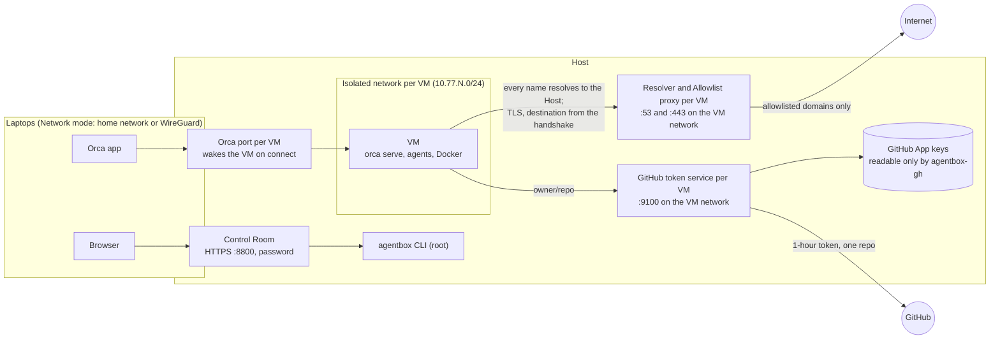

# Architecture

Terms follow [GLOSSARY.md](GLOSSARY.md). Decisions with lasting consequences are recorded in
[docs/adr/](docs/adr/).

## Threat model

1. **Rogue or manipulated agents.** An agent follows instructions planted in a repository,
   issue or web page and tries to read credentials, reach other machines or send data out.
2. **Supply-chain attacks through packages.** A dependency runs code at install or build time
   that steals tokens and spreads (Shai-Hulud, s1ngularity, chalk/debug, axios, TanStack, keyv).

Out of scope: theft of the Host, targeted attacks against its owner, attacks on the
laptops that drive the agents.

Where the layers below stop short against these two threats is listed in [What it does not
protect against](#what-it-does-not-protect-against); how to report a hole privately is in
[SECURITY.md](SECURITY.md).

## Overview

## Layers

### Host access
- SSH: key only, one admin user, no forwarding. The desktop can be turned off; the Host
  boots to a text console and the disk passphrase is entered over a remote keyboard. This is
  how the owner set up their Host; `agentbox setup` leaves sshd and the disk alone (see [The
  Host](#the-host) below).
- How far the Orca ports (one per VM) and the Control Room reach is the mode of the **Host
  setup** (`/etc/agentbox/host.json`, written only by `agentbox setup` on the Host, never by the
  Control Room). **Local-only**, the default: they listen on the loopback address only, and no
  firewall rule is added. **Network mode**: the Control Room listens on the bind address, the
  Orca ports on every address, and firewalld rich rules accept only the named home network on
  them; everything else on those ports is rejected. The rule covers the
  whole Orca port range 6801–7054, so a new VM needs no firewall change; only the ports of
  VMs in the registry have anything listening.
- The Host applies security updates daily (dnf5-automatic, set up by the owner, not by Agent
  Box) and never reboots on its own.
  Agent Box itself is updated only by the owner, with `dnf upgrade` of a Release
  ([docs/releasing.md](docs/releasing.md)).
- Everything that changes VMs, the Allowlist or credentials goes through the `agentbox`
  CLI: a root-owned Python package using only the standard library
  ([ADR 0006](docs/adr/0006-agentbox-is-a-dependency-free-python-package.md)), started with
  `python3 -I`. It validates every argument itself; `logs` and `pair` also run without root
  for members of the `libvirt` group. Every command has a `--json` form, and every command
  that changes something is recorded in **Activity** (see below).

### VMs
- One KVM VM per unit of separation ([ADR 0001](docs/adr/0001-vm-is-the-unit-of-separation.md),
  [ADR 0002](docs/adr/0002-vms-instead-of-containers.md)). Each has its own kernel, so a
  kernel exploit inside a VM does not reach the Host.
- Each VM is one record in the **VM registry** (`/etc/agentbox/vms/<name>.json`, root-owned);
  it holds, among others, the VM's memory limit, Data disk size and Container image cleanup
  (on or off, and its days).
  `agentbox regenerate` derives everything else from it: the libvirt network and the domain
  (through virt-install), the proxy, token-service and Orca-port units, the nftables rules,
  the storage pool of the disks, the Data disk, the placeholders for the Claude token and the
  OpenCode key and the file of its VM variables. Running it again changes nothing; a changed definition applies at the
  VM's next start, and not while the VM is paused. A VM network whose resolver differs from
  the current definition is defined again and, when active, stopped and started, since
  libvirt's dnsmasq reads its options only when the network starts; a VM running on it has no network until its next
  Restart (libvirt does not reconnect a running VM to a restarted network), which
  `regenerate` says. It also opens the ports the VMs reach in the firewalld zone `libvirt`
  (as setup does, step 5), before any VM network comes up, so it needs firewalld running. A socket whose unit text changed is restarted after systemd read it, so
  it listens on its new address (systemd keeps an active socket where it was); the proxy,
  which holds its listening socket, is stopped first and starts again with the next
  connection. Network numbers and names are fixed once a VM exists. A broken record
  stops `regenerate`; `status` and the daily Reset check carry on with the other VMs.
- `agentbox create` adds a record with the lowest free network number (Orca port 6800 + N),
  no Allowlist entries of its own (optionally a one-time copy of another VM's own entries,
  [ADR 0001](docs/adr/0001-vm-is-the-unit-of-separation.md)) and a System disk, then runs
  `regenerate`. It refuses names the CLI or the Control Room use themselves and anything an
  earlier VM of that name left behind (Data disk, Claude token, OpenCode key, VM variables,
  Observer, domain, network), so nothing carries over between VMs. The VM starts on its first `agentbox pair` or Orca
  connection.
- `agentbox set-memory` changes a VM's memory limit (1024 MiB up to the Host's memory, as
  in `create`): it writes the record and defines the domain again (the `regenerate` step for
  that VM), holding the registry lock, the record's lock and the VM's lifecycle lock, so no
  Pause comes between its check and the new definition (in that order, as `delete` does; so
  while it waits for a Reset or Pause of the VM to finish, create, delete and `regenerate`
  wait as well). libvirt keeps a new definition of a
  running VM for its next start, so the VM keeps running with its memory until a Restart or
  Reset; a reboot inside the VM keeps the QEMU process and is not enough. Nothing is changed
  live: QEMU cannot raise a running VM's maximum (`virsh setmaxmem --live`), and lowering it
  with the balloon (`setmem --live`) would take memory away from working agents. A paused VM
  is refused, since its saved memory belongs to the old definition; started again, it can be
  changed. The command says which applies (next start or next Restart) and is recorded in
  Activity like every change.
- **VM variables** ([ADR 0016](docs/adr/0016-vm-variables-are-checked-on-the-host-and-passed-as-an-fw-cfg-file.md))
  are environment variables of one VM (`"env"` in its record), for what a
  project needs in the VM and that is not secret (a `DATABASE_URL`, a tool's mode): `agentbox
  env`, `set-env <vm> NAME=VALUE... [--replace]`, `unset-env`, and a table on the VM's page
  in the Control Room. They reach `orca serve`, the agents and terminals it starts (all
  inherit its environment) and login shells. A change applies at the VM's next start, so a
  running or paused VM keeps the variables it started with until a Restart or Reset; a
  reboot inside the VM keeps the QEMU process and is not enough. The command holds the
  registry lock, the record's lock and the VM's lifecycle lock, as `set-memory` does, checks
  everything first and changes nothing on any error; it saves the record, then writes the
  file the VM reads at boot, then defines the VM again when its definition changed (a run
  that dies in between is finished by `regenerate`). That is the case for a domain defined
  before VM variables, which lacks the file's fw_cfg entry: an upgrade runs no `regenerate`,
  so `set-env` and `unset-env` define it, and a failed definition keeps the variables saved
  and says `agentbox regenerate` finishes it (`env_not_applied`). A paused VM is not refused;
  if its definition changed, it is defined again only once it no longer has a Pause (by
  `regenerate`, like every changed definition), and the command says so. At most
  64 variables, names `^[A-Za-z_][A-Za-z0-9_]*$` up to 64 characters, values up to 4 KiB of
  UTF-8 without control characters other than tab (so no NUL and no line break). VM
  variables never switch a Safeguard off: the Host refuses every name a Safeguard or Agent
  Box itself reads (see Images and Builds).
  A record keeps a variable whose name a later release refuses, so the record stays valid (a
  broken one would stop `regenerate` and `create` for every VM), but the VM never gets it: the
  file the VM reads leaves it out, `agentbox env` and `describe` mark it as not passed on, and
  `set-env` still refuses the name, while `unset-env` removes it.
  In Activity, a list of VM variables too long for an entry says how many it leaves out, and
  the description names the variables before it shows any value.
  `systemctl set-environment` is not used, so services started apart from `orca serve` (the
  user manager `user@1000`, rootless Podman) do not see them; containers never inherit them
  anyway.
- `agentbox delete` needs the name typed again (`--confirm`). It moves the record into a
  marker under `/var/lib/agentbox/pending`, so nothing wakes or regenerates the VM, then
  stops the VM and removes its domain (with any Pause), network, units, Claude token, OpenCode
  key, VM variables, Observer directory and its own Allowlist entries. The System disk is deleted, the Data disk archived
  under `/var/lib/agentbox/archive` unless deleting it is asked for. The VM's nftables rule
  stays until its network is gone; running `delete` again finishes an interrupted run.
  Create, delete and `regenerate` hold one lock, so two creates never get the same network.
- Each VM uses one **Image** (see Images and Builds below): the **Base image**, a Fedora
  bootc image built from `vm/Containerfile` with agents, Orca, Node, Bun, uv, Rust, Podman
  with Docker Compose and every **Safeguard**, or an Image built on it.
- **System disk** is a copy-on-write layer over a **Build** of the VM's Image and is replaced
  on every **Reset**.
  **Data disk** keeps repositories, Orca's identity and pairings, agent transcripts (Claude
  Code's `~/.claude/projects`, codex's `~/.codex/sessions`, opencode's sessions and chosen
  model in `~/.local/share/opencode` and `~/.local/state/opencode`), build
  caches and the agent's Podman storage ([ADR 0017](docs/adr/0017-containers-live-on-the-data-disk.md)):
  the VM's containers with their Container images and volumes survive a Reset and come back
  stopped, and nothing else of Podman's user configuration is kept. Agent settings and hooks
  are not kept, so nothing planted there survives a Reset.
- A VM learns its name, Orca port, Pairing address, Claude token, OpenCode key and VM
  variables from the Host at boot (QEMU fw_cfg); neither the token nor the key touches the
  Data disk. Logins made in the VM land next to opencode's sessions on the Data disk
  (`auth.json` from `opencode auth login`, `mcp-auth.json` with MCP servers' OAuth tokens,
  the login tables of `opencode.db`); `guest-setup` deletes them at every start, keeping the
  sessions, so none outlives the next one, like a Codex login, which stays on the System
  disk. So do approvals saved as "always" (`opencode.db`'s `permission` table and each
  session's own rules) and the commands opencode runs when it creates a worktree
  (`project.commands`, `workspace.extra`), like agent settings; triggers and views, which
  opencode never makes, are dropped first, so none can put the rows back. A file it cannot
  remove is reported, and a run past 60 seconds is ended: neither stops the start. This
  covers `opencode.db` only, not a database opencode is pointed at otherwise (`OPENCODE_DB`,
  another release channel). The token and the VM
  variables are files QEMU reads (`root:qemu`, mode 0640, in directories of mode 0750),
  never values in virt-install's `--sysinfo`, which it splits at commas: the VM variables
  are `/var/lib/agentbox/vm-env/<vm>.env`, entry `opt/agentbox/env`, one line
  `NAME=<base64 of the value>` per variable, or `none` without any (QEMU refuses empty
  fw_cfg files). `guest-setup` hands them on with `/usr/lib/agentbox/fwcfg-env` at every
  boot, before `orca serve` starts: it checks the form of each name again (the Host already
  left out every refused name), decodes the value with
  `base64 -d`, evaluates nothing, leaves a bad line out with a message in the journal, and
  writes the variables quoted into `/run/agentbox/env` (the unit's `EnvironmentFile`) and
  `/run/agentbox/agent-env` (sourced by `/etc/profile.d/agentbox.sh` for shells), before
  the fixed values of Agent Box, which so win. A domain defined before the entry existed has
  none, which counts as no variables.
- The Host never mounts a VM's disks. It reads a VM's journal (`agentbox logs`, and the
  Pairing code for `agentbox pair`) by having the VM's guest agent run `journalctl` inside
  the VM, without a shell and under a time limit, through a wrapper in the Image that starts
  nothing else. SELinux lets the guest agent run it only from its unconfined-hook directory
  with `virt_qemu_ga_run_unconfined` on, which `guest-setup` sets at boot; this widens
  nothing beyond the VM. Only fixed, validated filters reach the
  VM; everything that comes back is treated as untrusted: control characters are removed
  and Pairing codes hidden. The Host puts the records in order itself (journald's sequence
  number, else time since boot, else wall-clock time, else as written): with a search,
  `journalctl` in the VM writes the newest first. A compromised VM can forge its own logs
  and their order, so evidence of what a VM did on the network comes from the Host's proxy
  and token-service logs.
- Paired devices (`agentbox pairings`, `revoke-pairings`) are read and revoked the same way,
  through a second fixed wrapper in the Image (`agentbox-devices`: `list` and `revoke-all`
  only). Orca offers no CLI/RPC for devices (only its desktop GUI): they live in
  `orca-devices.json` in its data directory, its identity in `orca-e2ee-keypair.json`. `list`
  prints id, name, scope and times, never tokens; the Observer is the device the Host's own
  Orca data directory names as its paired device. Removing a single device would mean editing
  the registry under a running Orca (which overwrites it), so it is not offered. `revoke-all`
  stops Orca, deletes both files and starts it: a new identity, every device must pair again;
  the Host then re-pairs as Observer with the new Pairing code, which it never prints or logs.
  Revoking needs `--confirm <vm>`; the Control Room's pair action needs `confirm: true`.
- `agentbox import <vm> <folder> [<target>]` copies a folder of the Host into a VM, unpacked
  under `~/code` on its Data disk ([ADR
  0015](docs/adr/0015-folders-go-into-a-vm-as-a-read-only-tar-disk.md)). The Host packs it
  with `tarfile` into `/var/lib/agentbox/transfers/<vm>-<id>.tar`, with the rights of the user
  who ran `sudo` (in a root shell: of the folder's owner), so a user can send only what they
  could read themselves: of a Git repository the whole `.git` and every file `git ls-files
  --cached --others --exclude-standard` lists, so ignored files stay out; of a folder without
  Git everything; a linked worktree is refused. Symbolic links stay links, links leading out
  of the folder and special files are skipped and named, and the archive carries no owner and
  no setuid bits. The tar file is attached to the running VM as a raw read-only disk with the
  serial `agentbox-inbox`, without a filesystem, and the guest agent runs a third fixed
  wrapper in the Image (`agentbox-inbox receive <device> <target>`). It opens the disk as
  root, drops to the user `agent` before it reads it and unpacks with `tarfile`'s `data`
  filter, so nothing lands outside the target and no device file or setuid bit arrives; the
  target must be a new directory under `~/code` (missing parents are created and removed again
  after a failure, an existing one is refused, nothing is overwritten), and hooks in
  `.git/hooks` (also of nested repositories and submodules) other than the samples are
  removed. Only a JSON result with two whole numbers (files, bytes) comes back and is checked
  as untrusted. The disk is detached and the tar file deleted after success and after every
  failure; a disk an interrupted import left behind is detached before the next one attaches,
  and each import holds a lock on its tar file, so the next one deletes the files of imports
  that were killed hard. A VM that is off is started as `pair` starts it, a paused one is
  refused, and a VM whose Build lacks the wrapper fails with `inbox_missing`. Every import is
  recorded in Activity with folder, target, files and bytes.
- The **Container image cleanup** keeps a VM's Data disk from filling up with Container images
  nobody uses any more ([ADR 0017](docs/adr/0017-containers-live-on-the-data-disk.md)). Each
  record says whether it is on (`container_image_cleanup`) and after how many days
  (`container_image_cleanup_days`, 1 to 365); a record without them means on and 7 days.
  Inside the VM a user service of the agent (`agentbox-container-image-usage.service`, running
  whether the cleanup is on or off) follows `podman events` and keeps, per Container image, the
  time it was last used: pulled, built, or a container created or started from it. It keeps
  them in a file in the agent's Podman storage, so they survive a Reset with the Container
  images. Every hour `agentbox-container-image-cleanup.timer` (shipped in the RPM, `Persistent`,
  so a Host that slept or was off catches up) runs `agentbox cleanup-container-images`, which
  goes through the VM registry. The cleanup runs only in running VMs: it skips VMs whose
  cleanup is off and VMs that are off, paused or missing in libvirt, and never starts or wakes
  one. For each other VM it takes the VM's lifecycle lock without waiting (a VM whose lock is
  held is skipped for this hour) and holds it while the guest agent runs a fourth fixed wrapper
  in the Image (`agentbox-container-images prune <days>`), with a limit of 5 minutes. The
  wrapper drops to the user `agent` before it does anything and removes, through the agent's
  rootless Podman, only Container images that no container uses, running or stopped, and whose
  last use is more than that many calendar days ago; a Container image without a recorded use
  counts as used when the wrapper first sees it. It never removes a container or a volume, and
  removes only with `podman rmi`, never by force, so Podman itself refuses a Container image a
  container took meanwhile. Only a JSON result with two whole numbers (Container images
  removed, bytes freed) comes back; anything else from the VM, its error output included, is
  `container_image_cleanup_failed` and reaches neither the output nor Activity. A VM whose
  Build lacks the wrapper fails with `container_image_cleanup_missing`, a run past its limit
  with `vm_query_timeout`, and one VM failing never stops the others. A run that removed
  something is recorded in Activity (`container-image-cleanup.removed`, with the number, the
  bytes and the days), a failed one with its error code (`container-image-cleanup.failed`), a
  run that removed nothing or a VM that was skipped not at all.
- VMs are reset automatically once their System disk is seven days old, and with automatic
  updates (`auto_update`) once their Image has a newer current Build than the one their
  System disk came from (not when pinned to a Build), but only when no Orca client is
  connected and no agent is working (read from Orca as the Observer).
  They are never paused automatically; when the Host sleeps, the VMs sleep with it.
- Each VM has a lifecycle lock (`/var/lib/agentbox/locks/lifecycle-<vm>.lock`). What
  stops a VM and needs it to stay off holds it for its whole length: Reset (also the
  automatic one, which holds it from its checks on, and the one in `create`), Restart,
  Pause and the stop and undefine of `delete`. `agentbox import` holds it from the attach of
  its disk to the deletion of its tar file, so no Reset or Pause comes in between; the
  Container image cleanup holds it while its wrapper runs in the VM. What starts a VM (`start`, `wake` from a
  connection to its Orca port, `pair`) holds it only around "check the state, start"; `wake`
  does not hold it while it waits for Orca. So a connection during a Reset waits and then
  finds the VM running on its new System disk (or off after `--no-start`, and starts it).
  Without it, a wake on 2026-11-04 started `priv` on its old System disk while the Reset
  wrote the new one: libvirt fixes a disk's backing chain when it starts the VM, so QEMU
  kept the old Build under a disk whose header named the new one, and after the next cold
  start the VM no longer booted (#52). Reset therefore also checks, right before
  `qemu-img create`, that the domain is shut off (or not defined yet), else it stops and
  leaves the disk alone; it fails when the start afterwards fails (also "already active");
  and after the start it compares the backing file of the running System disk (`virsh
  dumpxml`) with the Build it just used, and forces the VM off and fails when they differ.
- When the Host shuts down or reboots, the VMs are shut down, not killed. `agentbox setup`
  enables libvirt's own `libvirt-guests.service` (settings in `/etc/sysconfig/libvirt-guests`).
  It shuts all running VMs down at once with the same `virsh shutdown` a Reset uses and
  waits up to 60 seconds; systemd then forces off any VM still running. libvirt orders
  every VM's `machine-qemu-*.scope` before `virt-guest-shutdown.target`, which
  libvirt-guests requires, so systemd ends no VM before libvirt-guests is done. Without
  it, systemd killed QEMU right at the start of the shutdown. Paused VMs are not running,
  so they keep their Pause. Nothing starts at boot (`ON_BOOT=ignore`); a VM starts on its
  first Orca connection or `agentbox pair`, as before. Once the shutdown is queued,
  systemd starts no Orca connection unit (they conflict with `shutdown.target`), so no
  `wake` brings a VM back. Stopping or restarting `libvirt-guests.service` by hand shuts
  all running VMs down.
- A VM that libvirt reports as running is not necessarily usable: after the Host's reboot
  on 2026-11-04 `priv` hung in the dracut emergency shell, every connection to its Orca port
  waited 120 s in `wake` and failed (about 1,870 times overnight), and the Control Room
  showed it as running (#54). Such a VM is now **Starting** while its QEMU process started
  less than the wake time limit ago and its Orca has not answered (accepted a connection on
  its port) since, and **Not responding** once Orca has not answered for that long (a look
  after the limit failed too; `watch` looks again when a start's limit runs out); a
  `guest-ping` tells whether the system did not boot or runs without Orca. The QEMU process
  is the one in libvirt's pid file (`/run/libvirt/qemu/agentbox-<vm>.pid`), not any process
  that names itself so; its start is read from `/proc` and identified by the boot id and
  its start in clock ticks. Times are compared on that clock (since the Host's boot), so
  setting the wall clock changes neither the start nor a state; it includes the time the
  Host slept, so a VM that was booting when the Host went to sleep can be **Not
  responding** after it wakes until Orca answers. What is known about the VM's current start
  is kept in `/var/lib/agentbox/wakes-<vm>.json`, which `wake` and `watch` write under its
  lock: the last time Orca answered (a wake reached it, or `watch` saw it; written when it
  is news, and at most every half time limit while Orca keeps answering), the first failure
  after that (`watch`'s first failed look, or when a `wake` that gave up began to wait),
  whether that incident has its Activity entry, and the wakes that gave up. `describe` asks
  once and `watch` every 15 s with the agents; both judge from their own last look and that
  file, so they agree but for how fresh their look is, and a `watch` started later knows
  what the one before found. Once Orca answered, one failed look does not switch a VM: the
  time limit must have passed from the first failure after the answer to a later failed
  look. A VM whose Orca has not answered since its start counts from its start when it was
  found silent within the time limit after it (`watch` looks at a VM as it starts, a `wake`
  that started it waits from then); one failed look at a VM nobody watched start (it ran
  before an update, or its wakes file is gone) is not enough. A `wake` that gives up waited
  the whole time limit in vain, so it counts as Orca not answering for that long. Each such wake (also the
  one in `agentbox observe`) is counted (time and remote address of the last) for the VM's
  current start, unless the VM stopped or started again, or Orca answered another wake or
  `watch`, while it waited; a wake that reaches Orca, a start, and Restart, Reset, Pause and
  delete once the VM is off clear the count. A VM that stops on its own keeps the count of
  its last start until it starts again.

### Network
- A VM's network reaches only the Host's resolver, proxy and token service on that network
  ([ADR 0014](docs/adr/0014-the-proxy-is-transparent.md)). It has no route to the internet,
  no IPv6, and cannot reach the home network or other VMs (nftables on the Host). The
  resolver is libvirt's dnsmasq on that network: it answers every name with the Host's
  address on it and forwards nothing (the dnsmasq options `address=/#/<host>`, `local=/#/`,
  `no-hosts` and `no-resolv` in the network's definition); any other record type (AAAA,
  HTTPS) gets an empty answer. So whatever a VM connects to, it connects to the Host, and
  the proxy there takes the real destination from the TLS handshake.
  A connection to any other port of the Host's address is refused at once (a TCP reset, ICMP
  port unreachable for UDP), so a program fails without waiting for a timeout; packets to
  other addresses and IPv6 are dropped.
- Containers in a VM are behind the same limits. They run on rootless Podman: `docker` is
  Podman under that name, and `podman compose` and `docker compose` run Docker Compose, which
  builds and starts containers through the agent's Podman socket. `guest-setup` writes the
  Host's address on the VM's network into `/etc/resolv.conf` as the VM's only nameserver
  (NetworkManager keeps out of it, `dns=none`). Containers resolve through it too: pasta
  forwards their queries to it, and aardvark, the resolver of compose networks, forwards to it
  the names it does not know. So containers and builds reach the outside through the proxy
  like the rest of the VM, and need no settings: no service, shell, container or build in the
  VM carries a proxy variable.
- From the home network a VM is reachable only through its Orca port; no other port of a VM
  is forwarded. Dev servers inside a VM are viewed in Orca's built-in browser: the page is
  shown on the laptop, but Orca carries its connections through the pairing connection
  (`network.browserTunnel`) and `orca serve` makes them inside the VM. `localhost` is the VM,
  and whatever the page loads from the internet goes through the proxy and the Allowlist
  like any other traffic of the VM. This needs Orca 1.4.232 or later on the laptop (checked
  in Orca's code): older clients route a tab through the VM only when the VM's Orca offers
  browser streaming, which a headless `orca serve` never does, so they show it as a page of
  the laptop.
- The proxy listens on port 443 of the Host's address in the VM's network, where the
  resolver sends every connection. It reads the TLS ClientHello a connection starts with
  and takes the destination from its server name (SNI; a ClientHello may span several
  records and TCP segments, in at most 16,389 bytes, one record of the longest length
  TLS allows), checks it against the **Allowlist**, resolves
  the name itself, refuses destinations that resolve to non-public addresses, and connects
  to port 443 there, passing the ClientHello on first; the client's own destination is
  always the Host and is ignored. What is no TLS handshake, or a ClientHello without a
  server name, is refused and logged with the client's address (`BLOCKED <address> (not a
  TLS handshake)`, `(no server name)`). A ClientHello with an Encrypted Client Hello
  extension is decided by its outer server name like any other: browsers send that
  extension in every handshake (GREASE) with the real destination outside it. A refused connection gets a fatal TLS alert
  (`access_denied` for a blocked destination, `unrecognized_name` without a server name,
  `internal_error` when the destination cannot be reached), so the client reports why;
  bytes that are no TLS get nothing. The proxy speaks no TLS itself: of a connection it
  sees the server name and nothing else.
- The Allowlist is one root-owned file, `/etc/agentbox/allowlist.json`, that the proxy reads
  directly and re-reads when it changes. Each **Allowlist entry** has a domain (covering its
  subdomains) or a pattern (a **Regex entry**, below), a scope (`all` or one VM), an optional
  expiry (15 minutes, 1 hour, 8 hours or 7 days; a **Temporary allowlist entry**), a note, and
  who added it when. Only the
  `agentbox` CLI writes it (`allow`, `disallow`, `extend`, `make-permanent`, `set-note`);
  a broken file leaves the proxy with the entries it read before. `agentbox
  migrate-allowlist` (run by `agentbox setup`) took over the earlier files
  `/etc/agentbox/allowlist` and `allowlist-<vm>`, every entry of them, and moved them aside
  as `*.migrated`; until then the proxy reads those.
- Destinations with strong **Signals** can be allowed, extended or made permanent only with
  `--force` on the CLI; the Control Room never passes it and refuses them with the reason.
  While the hand-maintained Watchlist cannot be read, every destination needs `--force`:
  which Signals are strong is unknown then, and Allowlist entries pass the proxy.
- **Regex entries** ([ADR 0013](docs/adr/0013-regex-entries-in-every-list.md)): every list
  (the Allowlist, the Watchlist, the Legitimate domains, the Harmless marks) can hold a
  regular expression in place of a domain (`regex` instead of `domain` in a record, the line
  `regex <pattern>` among the Harmless marks, `--regex PATTERN` on the CLI). It matches with
  `re.fullmatch` against the lowercased host name without its trailing dot, only hosts of at
  most 253 printable ASCII characters, and covers no subdomains of its own accord. The rules
  live in the classifier (`pattern_problem`), which the proxy loads and agentbox loads the
  same way, so both judge a pattern alike when it is added and whenever a list is read: at
  most 200 printable ASCII characters without spaces, it compiles, no uppercase letters,
  backreferences or lookarounds, no quantifier or alternative inside a repeated group, at
  most two quantifiers in a row that can take the same characters (the host comes from the
  VM, so no host may make a pattern backtrack for long), and, except on the Watchlist, it
  matches none of a fixed sample of unrelated hosts (`BREADTH_SAMPLE`: `.*\.com` is refused).
  Patterns are compiled whenever a list is read again, not per connection. A regex Allowlist
  entry never allows a destination with strong Signals, checked on every connection the way
  Open web does it (`--force` does not apply to it), and allows nothing while the Watchlist
  cannot be read; domain entries are checked only when they are added. `allow --regex` first
  shows which hosts of the scope's proxy log of the last 7 days (`ALLOWED` and `BLOCKED`
  lines) the pattern would allow, each with whether strong Signals keep it blocked, and adds
  it only with `--confirm-pattern`; `agentbox check-regex` answers the same for a pattern
  without adding it, and whether given hosts match. Scope, expiry, notes, uses and closing
  tunnels work as for a domain entry. The preview reads at most the newest 200,000 log lines
  and says first, with how far back it reaches, when a VM filled its log beyond them. A stored
  pattern the rules refuse (a hand edit, or a later Release with stricter rules or a larger
  sample) counts as nothing while the other entries keep working: it allows, silences or lifts
  nothing; on the Watchlist it keeps Open web and regex Allowlist entries closed until it is
  removed. The CLI lists it with the reason (`refused`) and removes it by its pattern.
- **Open web** lets a VM reach any public domain for a limited time. Destinations with strong
  **Signals** stay blocked, which includes **Watchlist** entries of a strong category and
  those of the threat-intelligence list; a `payload` entry only raises an Alert. While the
  hand-maintained Watchlist cannot be read, Open web lets nothing through.
- Tunnels follow [ADR 0005](docs/adr/0005-ending-access-closes-only-disallowed-tunnels.md):
  the proxy remembers what allowed each tunnel (entries, or only Open web) and checks once
  a second whether access was withdrawn. An entry that disappears before its expiry was
  removed on purpose; Open web ends when it is closed or runs out. The tunnels these
  allowed are closed unless another valid entry (or Open web still open) allows their
  destination. An expired entry stops new connections only; tunnels it allowed keep
  running, also after `agentbox expire-allowlist` (a timer, every minute) removes it and
  records the expiry in Activity.
- Every connection is logged per VM, into the journald namespace of Activity:
  `ALLOWED <host> (allowlist <domain> <scope>)`, `(allowlist regex <pattern> <scope>)` or
  `(open web)` (of several entries the most specific domain, else a pattern),
  `BLOCKED <host> (<reason>)` (for a destination only Open web or a regex entry would let
  through, `suspicious: <signals>` or `Watchlist unreadable, ... closed`),
  `ALERT <host> [<signals>]`, `CLOSED <host> (<reason>)` for a tunnel the proxy closed, and
  `BLOCKED <client address> (not a TLS handshake)` or `(no server name)` for a connection
  it took no destination from. `agentbox allowlist` counts each entry's uses of the last 24
  hours from the `ALLOWED` lines.

### Detection
`proxy/agentbox-suspicious` classifies each destination by:
- the Watchlist, matched by host suffix: entries kept by hand on the Host
  (`/etc/agentbox/watchlist.json`, each with a category that becomes its Signal and its
  source incident; a Regex entry matches by pattern) and the HaGeZi threat-intelligence list
  (Signal `threat`: malware, phishing, command-and-control),
- the HaGeZi list of newly registered domains (Signal `young`: registered in the last
  14 days, a weak Signal because many new domains are harmless),
- lookalikes of registry and vendor names (`npm-cache.com`, `pypi-get.com`, `npmjs.help`)
  and typos within edit distance 2 for names of at least five characters (`npnjs.com`;
  shorter names such as `pypa` are too often real words),
- raw IPs, in every form a resolver reads as an address (`16909060`, `0x01020304`, `1.2.3`,
  a name whose last label is all digits or `0x` and hex digits), cloud metadata addresses,
- blockchain RPC endpoints (used as command channels by GlassWorm and keyv), also below
  Legitimate domains,
- random-looking labels and unusual TLDs (weak signals).

**Legitimate domains** (registries, vendors, distributions; no hosting services such as
`amazonaws.com` or `vercel.app`) get no pattern Signals except the blockchain pattern, and
Feed hits for one or a subdomain of it do not count, so a broken feed cannot stop normal work
there. Three of the built-in ones are hosts of arbitrary user content,
`github.io`, `githubusercontent.com` and `claudeusercontent.com` (anyone's GitHub Pages site,
GitHub's raw-content hosts, the artifacts anyone shares from claude.ai): they keep the pattern
Signals off the brand as well, but Feed hits on their subdomains count, so a known phishing or
payload site there stays blocked in Open web unless an Allowlist entry covers it (see [What it
does not protect against](#what-it-does-not-protect-against); #59). The domains themselves keep
their treatment, as do
the brands' own domains such as `github.com`, `claude.ai`, `claude.com` and `anthropic.com`. No
Legitimate entry lifts those Feed hits again, also not one of the Host at or below a
user-content host (however specific), so one from before this rule stops suppressing them: the
list a new Host started with brought `claudeusercontent.com` as an entry of the Host, which
stays in its `legitimate.json` but lifts nothing below it. Built-in domains cannot be removed,
so no Host can switch the rule off. The classifier
lifts them when it classifies; `agentbox-feeds` stores the Feeds as fetched, so a removed
Legitimate domain counts again at once, and a Feed entry above one (`vendor.example` above
`cdn.vendor.example`) still counts for its other subdomains. Watchlist
entries kept by hand apply to Legitimate domains as well. Some Legitimate domains are built
into the classifier (`GENUINE`), the rest are kept on the Host
(`/etc/agentbox/legitimate.json`). A Legitimate domain that is a Regex entry lifts only weak
Signals (the young Feed, unusual TLDs, random-looking labels, many labels): which strong ones
a pattern would lift cannot be checked when it is added, so it needs no `--force` and never
makes a destination with strong Signals reachable in Open web.

Both hand-kept lists are records on the Host, like the Allowlist
([ADR 0009](docs/adr/0009-watchlist-and-legitimate-domains-live-on-the-host.md)):
- They are root-owned, written only by `agentbox` (`watch-add`, `watch-remove`,
  `legitimate-add`, …), and every change is an Activity entry.
- The classifier re-reads a record when it changes. For the Signals a broken record keeps
  its last good state. A Watchlist that cannot be read (`watchlist.json` broken, also in a
  single entry such as an unknown category, or missing without the text file from before)
  closes Open web, also when the proxy still holds an
  older state: the proxy logs `BLOCKED <host> (Watchlist unreadable, Open web closed)`, and
  only Allowlist entries let anything through. The Watchlist commands and `open-web` refuse
  with the reason until it is fixed, and `agentbox watchlist` shows it in place of the
  entries; only `watch-add --force` on the CLI creates a missing one (it opens Open web again, so the
  Control Room cannot), and `agentbox setup` does not refill it from
  the Release. A broken record of the Legitimate domains, also in a single entry, only adds
  Signals, so the proxy keeps its last good state (without one, only the built-in domains count);
  the self-test fails on it, `agentbox` refuses the Legitimate-domain commands with the reason,
  and `migrate-lists` with nothing to migrate only warns.
- A change that would make a destination with strong Signals reachable in Open web needs
  `--force`, which the Control Room never passes. That covers removing or weakening a strong
  Watchlist entry, and adding a Legitimate domain with strong Signals of its own (a Feed entry
  above it included) or threat-intelligence entries at or below it, also those a Legitimate
  domain of the Host lifts now (that one can go again), or any while the threat-intelligence
  list has not been fetched.
- `proxy/suspicious-domains` and `proxy/legitimate-domains` in the repository (in the RPM under
  `/usr/share/agentbox/lists`) only fill a new Host: `agentbox setup` installs
  them only where there is no record, no text file and no `*.migrated` file, and `agentbox
  migrate-lists` takes them over into the records. The migration
  never weakens an entry: a domain listed twice keeps its strongest category, and lines the
  records cannot take (an unknown category such as `threat`, an invalid name) leave it to
  `migrate-lists` on the Host, which names them; a change from the Control Room refuses then. A record
  lost after the migration stays missing, and setup says how to restore it (from a
  backup, or the state of the migration from the `*.migrated` file): the repository's list
  would be stale and open Open web again. Where neither the Watchlist record nor its text file
  exists, `migrate-lists` creates no Watchlist, because an empty one would open Open web with
  nothing on it.

The feeds come from HaGeZi's repositories on GitHub
([ADR 0004](docs/adr/0004-own-security-services.md)): `wildcard/tif-onlydomains.txt` of
`hagezi/dns-blocklists` (about 1.8 million domains) and `domains/nrd7.txt` plus
`domains/nrd14-8.txt` of `hagezi/nrd` (about 5 million), each rebuilt once a day and
licensed GPL-3.0 (the Host only downloads and uses them). `agentbox-feeds.timer` runs
`agentbox-feeds` every `feed_interval_hours` (12 by default) as the unprivileged user `agentbox-feeds`: HTTPS with
certificate check, at most 256 MiB per file (also unpacked), header and line checks, then
an atomic replace in `/var/lib/agentbox/feeds`. A list that fails any check keeps the
previous one; every run writes one journal line (`journalctl -t agentbox-feeds`) and the
state of each list (`status.json`, shown by `agentbox check-domain` and `agentbox watchlist`). The proxy never asks
anything over the network. The lists are stored sorted and searched through `mmap` with
binary search, so all proxies share one copy in the page cache (about 120 MB) instead of
each loading it: measured on the Host, a proxy keeps about 5 MB of its own memory and
needs about 0.1 ms per destination.

Hits raise an **Alert**, shown in the Control Room; Alerts can be marked as seen
(`agentbox mark-seen`) so that only new ones stand out. `agentbox check-domain` shows a
domain's Signals and the reason for each: an English text, and for the Control Room a stable
code with its parameters (the Watchlist entry or pattern and its source, the Feed entry, the
imitated brand or name, ...), which it words in its language
(`docs/control-room-api.md`), and the Harmless mark and Legitimate domain that cover it,
domain or pattern.
A **Harmless mark** (`agentbox mark-harmless`,
root-owned `/etc/agentbox/harmless`, a domain per line or `regex <pattern>`) stops Alerts for
a false positive and its subdomains (or the hosts its pattern matches), but nothing else: a destination with strong Signals stays blocked in Open web and can only
be allowed with `--force`, so marking a domain harmless never opens a way out. Signals
that do not depend on the name (raw IP, metadata address) still raise Alerts.

`agentbox setup` runs a self-test of the detection before it changes anything
(`agentbox-suspicious --self-test`): it starts the proxy of the installed Release on a socket
with the Host's lists plus test entries and small test lists (for each list its record,
before the migration its text file, on a fresh Host the Release's), sends TLS ClientHellos and checks the Alerts and blocks it logs, without
resolving any name. Besides its own test entries it checks one real Watchlist entry of the
Host, so a list that does not load is noticed, and that a broken Watchlist closes Open web.
Its cases use names under `.example` besides the built-in Legitimate domains, and a Host
entry covering one of them is expected as well, so ordinary entries cannot fail it. One case
is a Feed hit on a `github.io` subdomain, another on a `claudeusercontent.com` subdomain, both
counting as user content (above). It covers
one Regex entry per list, in lists of only its own test entries (the text files from before
the records have no patterns): a Watchlist pattern raises its Signal, a Legitimate pattern
lifts a weak Signal but not a strong one, a Harmless pattern stops an Alert, and an Allowlist
pattern lets through neither a destination with strong Signals nor anything while the
Watchlist cannot be read. A
failure stops setup and the installation.

The approach sees host names only: abuse of allowed services such as GitHub is not
visible here and is limited by token scope (see [Egress](#egress) and [What detection
sees](#what-detection-sees) below).

### Credentials
- **GitHub:** a GitHub App issues installation tokens valid for one repository and one hour,
  with contents, issues and pull requests write, checks and statuses read, and no
  workflows or administration rights, so agents cannot create repositories or change CI.
  The App keys are readable only by the `agentbox-gh` system user. A VM asks the token service
  over its network; each VM may only get tokens for the **GitHub owners** in its registry record. Git uses a
  credential helper, `gh` a wrapper, both fetching a fresh token per use. The token service
  is the Apps' only use: Builds take the installed Release's files and ask GitHub nothing
  (see Images and Builds).
- **Several GitHub Apps:** the Host keeps any number of Apps, one per trust boundary (an
  organisation's App whose key its admins may hold, a personal App for private repositories).
  `/etc/agentbox/github/app.conf` (group `agentbox-gh`, mode 0640) names them, one
  `APP_ID=<id>` line each, and `app-<id>.pem` (owner `agentbox-gh`, mode 0400) is each App's
  key. There is no mapping from GitHub owners to Apps: only once the owner check passed does
  the token service ask the Apps in ascending App ID for `GET /repos/{owner}/{repo}/installation`,
  and the first App installed there issues the token; its log line names that App. A 404 from
  one App means it is not installed there and the next one is asked; no App installed is
  `not-installed`. Any other answer from GitHub (an error status, a key GitHub refuses) ends the
  request with `github-status`, so a passing failure of one App never lets another App issue
  the token. A key that cannot sign (its file missing or broken) ends it as well, with
  `app-key`; every refusal that stops at an App names its App ID.
- **Claude:** one **Claude token** per VM from `claude setup-token`, stored on the Host and passed in at
  boot; revocable per VM. Such tokens cannot load an organisation's managed settings, and
  cannot fetch the account's claude.ai connectors (Gmail, Drive, Calendar, ...): those would
  let an agent read and write the owner's data through Anthropic's hosts, which are on every
  Allowlist, and the proxy would see nothing but an allowed connection to them. A `/login`
  with the owner's claude.ai account inside the VM would bring them in, so the Image also
  sets `ENABLE_CLAUDEAI_MCP_SERVERS=false` for every service and shell, and each Build is
  checked for it (a Safeguard, see Images and Builds). That variable is a default and does
  not stop code in the VM. Such code can start Claude Code with the variable changed, or
  switch it back in Claude Code's user or project settings (`env` in `~/.claude/settings.json`
  or in a repository's `.claude/settings.json`). Either way, it would still need a claude.ai
  login in the VM.
- **OpenCode:** one **OpenCode key** per VM, an API key from opencode.ai (OpenCode Go, the
  subscription, or Zen), stored on the Host in `/etc/agentbox/secrets/opencode-<vm>` and
  passed in at boot (fw_cfg `opt/agentbox/opencode_key`); `guest-setup` hands it to every
  agent and terminal as `OPENCODE_API_KEY`, which opencode reads for both providers. A
  Claude subscription token is no use there: Anthropic allows it only in Claude Code.
- No package-publishing tokens exist anywhere on the box.

Replacing a credential never breaks a working one:
- `agentbox set-claude-token` checks the form (`sk-ant-`, only the characters such tokens
  have; API keys are refused because the VM uses the token as `CLAUDE_CODE_OAUTH_TOKEN`),
  then sends one minimal Messages API request with it. Anthropic documents no endpoint for
  checking these OAuth tokens, so the documented error type decides: an authentication,
  permission or billing error refuses the token; an answer, or an error that only comes once
  the token was accepted (invalid request, not found, rate limit), accepts it; anything else
  (no answer, overloaded, a page from a proxy) proves nothing and stores nothing. The new
  token replaces the old one in one rename with the file's mode and group, and takes effect
  at the VM's next start.
- `agentbox set-opencode-key` checks the form (`sk-`, the same characters as a Claude token;
  a Claude token or key is refused), then asks OpenCode Go's API for its models
  (`GET https://opencode.ai/inference/go/openai/v1/models`, which uses no quota) with it: a
  list of models accepts the key, an authentication or permission error refuses it, anything
  else proves nothing and stores nothing. Whether the account has a Go subscription is not
  checked. The new key replaces the old one like a Claude token, and takes effect at the
  VM's next start.
- `agentbox set-github-app` reads the App's private key from stdin, lets openssl parse it
  (unencrypted RSA only), signs a JWT with it and asks GitHub `GET /app`, whose answer must
  name the given App ID. Only then is the App's key written to `app-<id>.pem` (owner `agentbox-gh`, mode 0400), and
  then `app.conf` names the App, each in one rename; the other Apps stay as they are, so
  replacing one App's key never touches another's. The token service starts a process per
  request and reads the files then, so it uses the new key or App from the next request on,
  without a restart. `agentbox remove-github-app <id>` takes the App out of `app.conf` first,
  then deletes its key; it asks GitHub nothing.
- `agentbox github-app` signs a JWT with each stored key and lists every App's installations
  (`GET /app/installations`) next to the GitHub owners of every VM: which VMs rely on each
  installation, which owners no App is installed on (those VMs get no tokens there), and each
  App's link for installing it (`https://github.com/apps/<slug>/installations/new`). An App
  whose key or answer is no use is listed with its error, the others as usual; it counts as
  installed nowhere, so its owners show as missing until it is fixed (the token service
  refuses there as well).
- `agentbox github-tokens <vm>` reads the token service's log the way Activity does and
  lists the repositories a VM got tokens for and the requests it was refused, with reasons.
  The token service logs one English line per request, never the token; a refusal names a
  stable reason (`owner-not-allowed`, `not-installed`, ...) that the Control Room words.

Keys reach openssl through a pipe and JWTs and tokens reach curl on stdin, so no secret is
ever a process argument. Error messages never repeat input, and the Control Room removes
whatever it was sent as a secret from anything it answers or logs, should agentbox ever echo it.

### Packages
The Build installs the agents (Claude Code, codex, opencode) and the package managers with npm
`--before`, so it takes the newest versions published at least `package_min_age_days` of the
Settings ago (two days by default), and Orca from the newest GitHub release at least that old
unless `orca_version` pins one (Images, below).
Inside the Image: npm ignores install scripts, npm, pnpm, Bun and uv refuse versions younger
than that (written into the Base image at each Build by `package-safeguards`), and Git
ignores hooks from repositories in favour of a
global `pre-push` hook that refuses pushes to `main`/`master` (a brake against mistakes, not
a hard barrier). Docker images come through the proxy from Docker Hub, GHCR and Quay. Every
Build is checked for these Safeguards before a VM can use it (below).

### Images and Builds
Images are defined in the repository, ship with each Release and are built on the Host from
the installed Release's files (`VM_SOURCE`, see Where the files live;
[ADR 0010](docs/adr/0010-images-are-built-from-the-installed-release.md)), checked from the
Host after every Build
([ADR 0008](docs/adr/0008-safeguards-checked-from-the-host-after-every-build.md)). A push to
`main` changes no Build; installing a new Release does, from its next Build on:
- `vm/Containerfile` is the Base image (build context: `VM_SOURCE`, laid out as the
  repository: `vm/` and the guest tools of `github-app/`). Every other Image is
  `vm/images/<name>/Containerfile` (build context: its directory) and starts `FROM ${BASE}`,
  the Base image's current Build, which podman passes as a build argument.
- A Build runs as `agentbox-build@<image>.service` (`agentbox-build@all` builds the Base image
  and then every other Image on the new Base Build), generated by `regenerate`; its journal is
  its log ([ADR 0004](docs/adr/0004-own-security-services.md)). `agentbox build` starts the
  unit (the Control Room's `POST /api/build` calls it), naming who asked in a request file
  for the Activity entry; the Maintenance window (see Maintenance window) starts
  `agentbox-build@all` on `rebuild_day`. Builds run one at a time (a lock); an interrupted one
  is marked failed by the next.
- Steps: `agentbox` copies `VM_SOURCE` once for the whole run, so a package update during
  `build --all` cannot mix two Releases, and names the installed Release (`VERSION`) in each
  Build's record. `agentbox` fetches nothing and no GitHub token is involved. Then podman
  builds the container image (`--no-cache`, so agents and packages are fresh; the Base image
  with the build arguments `PACKAGE_MIN_AGE_DAYS` and `ORCA_VERSION` of the Settings, nothing
  mounted from the Host), `agentbox` checks the Safeguards and reads the versions of the
  tools from the same mounted files, bootc-image-builder makes the qcow2, and the link
  `images/<image>.qcow2` moves to `images/<image>-<build>.qcow2` in one rename. Each step is
  recorded in the Build's record under `/var/lib/agentbox/builds`, with the package minimum
  age and the Orca pin it was built with (a derived Image has its Base Build's).
- What the Base image downloads, it downloads inside the Build container, where Fedora's
  packages, the npm tools and Orca are chosen, fetched and checked; no root process on the
  Host parses what the internet answers (#113). Orca comes from its GitHub release
  (`stablyai/orca`) through `vm/build/orca-release`, which the Containerfile copies in and
  runs: it asks GitHub's API for the releases and takes exactly `orca_version` of the Settings
  when that is set, else the highest version that is no draft and no prerelease and was
  published at least `package_min_age_days` ago (the npm tools' rule); it downloads that
  release's `orca-ide-<version>.x86_64.rpm` with curl over HTTPS only (redirects too), with
  time limits and at most 1 GiB, from a URL it builds from the version, and checks it against
  the SHA-256 GitHub lists for the asset (`digest`). `dnf` installs it with its dependencies to
  `/opt/Orca`, which in a bootc image lies under `/var` and so outside the Image's `/usr`; it is
  moved to `/usr/lib/orca`, where `agentbox-orca.service` starts it and `agentbox` reads its
  version. Orca's server (`orca serve`) runs on a Node runtime Orca pins and otherwise
  downloads at its first start: the RPM carries the pin
  (`resources/app.asar.unpacked/out/shared/node-runtime-pin.js`: the Node version, the archive
  and its SHA-256, the SHA-256 and size of `bin/node`; `bin/node`'s SHA-256 again in
  `resources/orcad-template/targets/linux-x64-glibc/.runtime-node`), and the same script
  downloads that archive from `nodejs.org`, as Orca would, checks it against the pin and puts
  the checked `bin/node` into `/usr/lib/agentbox/orca-runtimes/node-<SHA-256>/`, from where
  `guest-setup` copies it into the agent's home at boot (where Orca looks for it). Any
  failure, a missing asset, a checksum that does not match, an answer that cannot be read,
  fails the Build. A Host from before keeps its `/etc/agentbox/build.conf` (Orca's Node
  runtime from the owner's home, `ORCA_RUNTIMES`); nothing reads it any more.
- The safeguard check (`agentbox/safeguards.py`) mounts the built image (`podman image mount`)
  and reads files; nothing from the Image runs, and links are resolved inside the Image. It
  verifies npm's global configuration (`ignore-scripts=true`, `min-release-age`, npm 12 or
  later), the minimum age for uv (`uv.toml` and `UV_EXCLUDE_NEWER`), pnpm and Bun, the Git
  hooks path and `pre-push` hook, the resolver (`guest-setup`'s nameserver line, `dns=none`,
  no `DNS=` or `FallbackDNS=` for systemd-resolved), no proxy variable or option in systemd's
  `DefaultEnvironment`, the four guest-agent
  wrappers (`agentbox-inbox` must drop to the agent and unpack with the `data` filter,
  `agentbox-container-images` must drop to the agent and remove only with `podman rmi`, never by
  force and never a container or volume), that Claude Code fetches no claude.ai connectors (`ENABLE_CLAUDEAI_MCP_SERVERS=false`
  in systemd's `DefaultEnvironment`, which reaches `orca serve`, the agents and terminals it
  starts, and exported last by `/etc/profile.d/agentbox.sh` for shells; see Credentials for
  why), and that the merged `DefaultEnvironment` sets no variable that switches a Safeguard
  off. A derived Image must also be built on the Base Build's layers, keep every Safeguard
  file, the Git hooks and the guest-agent wrappers identical to the Base Build's manifest, and
  add or change files where environment or configuration is read (Claude Code's managed
  settings in `/etc/claude-code` among them, read as decoded JSON like Claude Code reads
  them; one that does not parse fails) only without mentioning a Safeguard. A failed check
  discards the Build.
- A VM variable (see VMs) is set at runtime and never passes through this check, and
  `/run/agentbox/env` overrides systemd's `DefaultEnvironment` for `orca serve`. So the Host
  checks every name when it is set: it refuses names the check's own patterns know apart from
  proxy names (the variables that switch a Safeguard off and anything mentioning one, in
  either case:
  `GIT_CONFIG*`, `UV_NO_CONFIG`, `*IGNORE_SCRIPTS`, `*RELEASE_AGE`, `UV_EXCLUDE_NEWER`,
  `*HOOKS_PATH`, `*CLAUDEAI*`), what those patterns miss, also in either case
  (`npm_config_before`, which takes npm around the minimum release age), what Agent Box sets
  for the VM or every process reads first (`PATH`, `HOME`, `XDG_RUNTIME_DIR`, `LD_*`, `NODE_OPTIONS`, `BASH_ENV`,
  `ENV`, `CLAUDE_CODE_OAUTH_TOKEN`, `OPENCODE_API_KEY`, `AGENTBOX_*`, `ORCA_PORT`, `PAIRING_ADDRESS`) and every
  variable of the Image's `DefaultEnvironment`, held to those files by a test. Neither may a
  VM variable be one bash sets itself (its readonly variables `SHELLOPTS`, `BASHOPTS`, `UID`,
  `EUID`, `PPID`, `BASH_VERSINFO`, on which `export` fails in every login shell, `GROUPS`, and `IFS`, which
  would change the word splitting of every login-shell script after it). Broad prefixes
  such as `npm_config_*` or `UV_*` stay allowed: only what a Safeguard or Agent Box itself
  reads is blocked. Proxy variables and options (`HTTPS_PROXY`, `NO_PROXY`,
  `npm_config_proxy`, Java's proxy properties in `JAVA_TOOL_OPTIONS`, ...) stay allowed too,
  although the check refuses them in an Image: the VM reaches nothing but the Host (see
  Network), so a proxy variable switches no Safeguard off.
- Anything failing (the Release's files, podman, the check, the disk) leaves the previous
  Build current, deletes what the Build made and records `build.failed` or `build.rejected` in
  Activity with the reason; `build.ok` records a new current Build. The Build's log stays in
  the journal.
- A VM's record names its Image and an optional Build pin; `agentbox set-image` changes them
  and Reset reads them, so a change applies at the next Reset. After each Build the newest
  `builds_kept` Builds of the Image stay, and every Build that is current, a System disk's
  backing file or a VM's pin; nothing is deleted while a System disk cannot be read. Reset
  and pruning hold one lock, so a Build never goes between choosing it and creating a disk
  on it. Only the Base image's current container image is kept in podman's storage.
- Builds of the former `vm/build-disk.sh` (`base-YYYYMMDD-HHMM.qcow2` and `base.qcow2`) fit
  this layout and count as Builds of the Base image; nothing is moved, System disks keep
  their backing files. Derived Images need a Base Build made by `agentbox build`.
- Every Build records the versions of its tools (`agentbox/versions.py`), read like the
  Safeguards from the mounted filesystem, never by running anything from it: Orca's from the
  `package.json` in `/usr/lib/orca/resources/app.asar` (installed from its release), Claude
  Code's, codex's and opencode's from their `package.json` under `/usr/lib/node_modules`, and
  the Fedora release from `os-release`. What cannot be read is unknown and fails nothing;
  Builds made before recorded only the npm tools.
- What a new Build would bring is checked once a day on the Host, in two parts, so that
  nothing from the internet is parsed as root. The Maintenance window (daily, see Maintenance
  window; and `regenerate` at once when one of its services changed) starts
  `agentbox-versions.service` (generated by `regenerate`), which first pulls in
  `agentbox-versions-fetch.service`:
  - The fetch, `agentbox fetch-versions`, runs as the service user `agentbox-feeds` with no
    capabilities, a read-only system, no `/home`, and `/etc/agentbox`, the VMs' and Builds'
    directories, libvirt's and podman's state made inaccessible; it gets
    `package_min_age_days` from its unit and writes only its StateDirectory,
    `/var/lib/agentbox/available/available.json`. For each npm tool it reads the package's
    full metadata from the registry (`registry.npmjs.org`, through `curl -q`, HTTPS only, at
    most 64 MiB) and picks what npm `--before` would: the `latest` tag when it is at least
    `package_min_age_days` old, else the newest such release, deprecated ones last. For Orca
    it asks GitHub's API for Orca's releases (`api.github.com`) and picks by the rule of
    `vm/build/orca-release` (the tests hold the two to the same choice), only a release whose
    x86_64 RPM GitHub lists with a SHA-256; nothing is downloaded. Like the minimum age it
    gets `orca_version` from its unit; it records the pin it used.
  - The root part, `agentbox check-versions`, reads that file as untrusted input: never
    through a link, a regular file of at most 64 KiB, JSON of the expected shape, written in
    the last three days; every version and Orca's pin are checked again against the patterns
    the Builds use and an error must be one the fetch reports. Anything else is unknown (so is
    Orca in a file or `versions.json` from before #113, which named the Host's `/opt/Orca` and
    the newest release instead). It adds, for each Image
    whose current Build's container image is kept (the Base image), the Fedora package updates
    counted with `dnf check-update` in a container from that Build (podman, out to the Fedora
    mirrors), named `agentbox-check-<image>`, with no capabilities, `no-new-privileges` and a
    read-only root, and ended after five minutes. It alone writes
    `/var/lib/agentbox/versions.json`, in one rename. The count takes no lock a Build waits
    for: a Build removes container images with `podman rmi --force`, which ends a count still
    running from one, and that count is then unknown. Checks run one at a time.
  Whatever fails stays unknown (`null`), is said once on stderr and never blocks a Build or a
  Reset; the check records no Activity of its own, only the start of an automatic update
  (below).
- An **Update** brings new versions to VMs: a Build of one Image and, once it is the Image's
  current Build, a Reset of the VMs the owner picked onto it (`agentbox build <image> --reset
  <vm>...`, `POST /api/v1/builds` with `reset`, the Update button of an Image in the Control
  Room, whose confirmation says that sessions in those VMs end and their Data disks stay).
  `build` accepts only VMs that use the Image without a Build pin (their Reset would not bring
  the new Build) and names them in the request file next to the actor; the Build's unit
  resets them after the Build, outside the run lock (`lifecycle.reset_as_found`): under each
  VM's lifecycle lock it reads whether the VM runs, resets it onto the Image's current Build
  at that moment (normally the new one; the entry names the Build used), and starts it again
  if it ran. A Reset that fails or is stopped before the System disk is touched starts a VM
  that ran again on its old disk; otherwise the entry says whether the VM runs or stays off.
  Each Reset, done, failed or never begun, is an Activity entry `reset.update` with the actor
  who asked; a failed Build resets nothing and says so for each VM, and so does a unit stopped
  during the Resets for those not reset yet. A VM that changed its Image or got a pin meanwhile is left alone. There
  is no update inside a running VM: the next Reset would undo it, and it would bypass the
  Safeguard check of the Build.
- An **update of every Image** (#114) runs as `agentbox-build@update.service` (`build-run
  update`, the template of the Builds, so its Builds have their log and live progress like
  any other). Under the run lock it decides which Images to build (`images.update_images`):
  those whose `update` is true and that the installed Release defines; when the Base image is
  one of them, every Image, built on the new Base Build as `build --all` does. Deciding under
  the lock means a Build that ran while it waited counts: what it brought is not built again,
  and with nothing left it builds nothing (`build.unneeded`). Its Builds are recorded with the
  reason `update`. Two things start it:
  - **Automatic updates** (`auto_update` of the Settings, on by default): after the daily
    check, `check-versions` starts it at once when an Image has an update, with the request
    file of a Build (actor `timer`, nothing to reset), and records `build.automatic` with the
    reason `update` and what would change. It never waits: while the run lock is held (a
    Build runs) or the update's unit runs, it does not start one and the next check tries
    again (recorded as `build.skipped`, reason `update`; an active `agentbox-build@` unit counts as busy, even before it holds the lock), so Builds never run two at once and the check is never held up. Changing `orca_version` or `package_min_age_days` re-runs the check via `regenerate`, so with `auto_update` an update can start at that time of day (Resets still only in the Maintenance window). The Reset
    check of the Maintenance window, which begins only once those Builds have finished, then also resets each VM whose Image has a newer current Build than the Build its
    System disk came from (`images.behind`; read from the disk's backing file under the VM's
    lifecycle lock; a VM pinned to a Build, or whose disk came from another Image, is left
    alone), with the rules and the Activity entries of the Reset by age: only when idle, else
    postponed to the next night (`reset.postponed` with why); a done one is
    `reset.automatic` with the reason `update`, both name the new Build. `describe` marks
    such a VM `reset_due`. With `auto_update` off, the check only checks and the Reset check
    goes by age alone, as before.
  - **Update now** (`agentbox update-now [--reset <vm>]...`, `POST /api/v1/updates`, the
    Update now button of the System page with the confirmation of an Update): the request
    file names the actor, the VMs and the Image each used when picked (any Image, no Build
    pin), and that the versions are checked first: the unit starts the fetch's unit
    (`systemctl start agentbox-versions-fetch.service`, which waits for it; the fetch runs as
    `agentbox-feeds` as every day) and then runs the root part itself, which starts no
    automatic update. Then the Builds under the run lock as above, and when every Build
    succeeded, the Resets of the VMs picked onto the current Build of their Image, as the
    Resets of an Update (`reset.update`, `lifecycle.reset_as_found`, outside the run lock; a
    VM that changed its Image or got a pin meanwhile is left alone). A failed Build, or an
    update stopped before the Resets, resets nothing and says so for each VM.
  `agentbox images` (`updating`) says while that unit runs, also while it still checks; the
  Control Room also follows the unit in the `services` event and reloads the Images when it
  ends. An Image cannot be named `all` or `update`.
- `agentbox images` and `GET /api/images` show both: each Build's `tools` and the tools a new
  Build would change (`updates`: an npm tool with a newer version, Orca with another one,
  which a pinned `orca_version` may make an older one), per Image the package updates of its
  current Build and whether a new Build would bring anything (`update`), and what the check
  found (`available`, with the pin of the Settings; Orca there is unknown while the last check
  took it with another pin, until the check a changed pin starts). The Control Room shows
  them on the System page for each Image's current Build, and on a VM's page for the Build
  its System disk came from.
- The Control Room reads `GET /api/images` and a Build's log with `GET
  /api/images/<image>/log?after_cursor=`. It shows the installed Release the next Build takes
  and, for each Build, the Release it came from; Builds made before ADR 0010 have no Release in
  their record and show the commit of `main` they came from instead. While a Build runs,
  `agentbox watch` follows its unit's journal and the Build records and the stream carries
  `build` (status and step) and `build-log` (new lines) events; the log endpoint fills gaps.
- Each Image's definition (#67): `agentbox images` names its Containerfile (`containerfile`,
  the path in the repository) and links it on GitHub at what its current Build came from
  (`containerfile_url`: the tag `v<release>` of the Build's Release, or the commit and
  repository a record from before ADR 0010 names; none for a checkout's `0.0.0` or when neither
  is recorded), and names the repository the Releases come from (`version.REPOSITORY`).
  `agentbox containerfile <image>` (`GET /api/v1/images/<image>/containerfile`) reads the
  Containerfile of the installed Release, which the next Build takes: a regular file under
  `VM_SOURCE`, never through a link, at most 64 KiB, returned as text without control
  characters and with anything that looks like a token or key hidden. The Control Room links
  both, shows the text on request and says when the current Build came from another Release.
  Nothing is fetched from GitHub for either, and no token is involved; the text has its own
  endpoint so that `GET /api/images`, read on every Build event, stays small.

### Control Room
A small Python standard-library service running as an unprivileged user; every action is one
call of `sudo agentbox <command> …` with fixed arguments, the command first, naming the
browser's device (from its User-Agent) and address as the actor right after it. The Control
Room's commands are `CONTROL_ROOM_COMMANDS` in `agentbox/cli.py`; tests hold it equal to the
commands the backend runs and to the list in its sudoers rule. That rule lets `agentbox-web`
run `agentbox` only with one of these commands as the first argument (a sudoers regular
expression, sudo 1.9.10 or later). Since sudo matches the arguments joined with spaces, a first
argument such as `start setup` still passes it; agentbox knows no such command. Called through
`sudo` by `agentbox-web`, agentbox itself also runs only these commands, and refuses every other
command and `--force` before anything runs (`control_room_refused`), which no sudoers rule could
tell from a note that contains it. So even a taken-over backend cannot run `setup`, `import` or
`regenerate`, or lift strong Signals, and agentbox's own check holds should sudo's matching ever
be got around. HTTPS with a self-signed certificate, a password with scrypt, sessions in
memory, a login brake after five failures, CSRF protection via a custom header and
`SameSite=Strict`. Sign-ins (successful, failed, refused by the brake) and sign-outs are
Activity entries with address and device. Pairing codes, tokens
and passwords never appear in logs.

Host readings come without privileges, every five seconds, from the kernel and `nvidia-smi`
(`web/agentbox-readings`): CPU load (`/proc/stat`, `/proc/loadavg`), CPU temperature (hwmon
`k10temp`, `zenpower` or `coretemp`), memory and swap (`/proc/meminfo`), swap activity (`pswpin` and `pswpout` in
`/proc/vmstat`, MiB/s between two samples, `pending` on the first), GPU temperature,
load, memory and power (`nvidia-smi`), NVMe temperatures (hwmon `nvme`), and memory per VM
(resident memory of the VM's QEMU process, the number `virsh dommemstat` reports). CPU power
comes from the powercap energy counter, which current kernels let only root read; like any
reading that cannot be read, it is reported as unavailable, never estimated. The backend
keeps 30 minutes of history and marks readings at or above a threshold (built-in defaults
until Settings make them configurable). `GET /api/host` returns readings, thresholds and
history.

`GET /api/events` (also `/api/v1/events`) is the backend's single Server-Sent Events stream.
Every connection starts with a `hello` event (`resumed`: whether the events missed since the
browser's `Last-Event-ID` follow) and, when not resumed, the latest state: `host` (readings),
`version` (the installed UI), `watch` (whether the root helper runs), `state` (every VM),
`host-reboot` and `services`. Events after that carry ids `<stream>-<n>`, where the stream
part changes on every restart of the backend. The last 256 events can be replayed after a
reconnect; a client that falls further behind is disconnected and starts fresh. An idle
stream gets a comment every 15 s, a stream ends with its session, and at most eight streams
run at once.

Everything the unprivileged backend cannot see comes from one root helper, `agentbox watch`,
which the backend starts once through sudo for all clients and starts again when it ends (1 s
to 60 s apart). It writes one JSON line per event, and changes nothing but what it learns
about a VM's answers (the VM's wakes file) and records Activity only for a VM it finds not
responding (see Activity): VM objects
(`agentbox describe --json`: state, agents, whether the VM answers and its failed wakes,
System disk and its Build, Image and pin, devices on the Orca port from the
`agentbox-gui-<vm>@` instances) when one changes, polled every 3 s (agents and whether Orca
answers every 15 s) rather than taken from libvirt's events, because most of the object is
not libvirt's; Activity, Alerts and GitHub tokens from following the journald namespace
`agentbox`; Build records and the build unit's journal; the Host's agentbox units; and
whether updates need a reboot (`dnf -C needs-restarting -r`, every six hours). It cleans
entries like `agentbox activity` does and passes every string through the token, key and
Pairing-code patterns once more. It ends when the backend closes its stdin. The backend
turns Alerts, refused GitHub tokens, failed or rejected Builds, a needed reboot and
temperatures reaching their threshold into `notification` events (kind, severity, VM, short
English text); which of them a browser shows is its own choice.

The versioned API `/api/v1/...` serves the new UI (reference:
[docs/control-room-api.md](docs/control-room-api.md)): one `agentbox` call per request as
before, errors as `{"error": {"code", "message", "detail"}}` with a stable code, an English
message and agentbox's own text only as detail. agentbox names the code where the failure
arises and, called with `--json`, writes it as a JSON object on stderr; the backend maps it
to the HTTP status with a table, never by the wording, and only the UI translates
([ADR 0012](docs/adr/0012-the-server-speaks-english-with-stable-codes.md)). The unversioned
endpoints stay for the old UI until the new one replaces it. The new UI is a static Nuxt build
([ADR 0003](docs/adr/0003-no-node-on-the-host.md)) of the source in `web/ui/` (developed and
tested with Vitest in a VM, [web/ui/README.md](web/ui/README.md)), generated into `web/ui/dist/`.
That build is not committed: CI builds it from the lockfile, for the tests of every pull
request and as an artifact only for a Release
([ADR 0011](docs/adr/0011-the-control-room-ui-is-built-in-ci.md)). The RPM ships it in
`/usr/share/agentbox/web/ui/`. The backend serves it with the SPA fallback to `index.html`, long
caching for the hashed files under `/_nuxt/` and `/_fonts/`, and a Content-Security-Policy
of `'self'` plus the sha256 hashes of the inline scripts and styles of that `index.html`,
computed when it is loaded; a changed `index.html` is a new version, sent to open pages as a
`version` event. Without a new build the old UI is served as before; with one, it stays at
`/legacy/`. The backend also serves the Activity timeline (`GET /api/activity` with the filters of `agentbox activity`) and
credentials: `POST /api/<vm>/claude-token`, `POST /api/github-app` (App ID and private key:
adds the App or replaces its key), `GET /api/github-app` (every App's installations and missing
GitHub owners) and
`GET /api/<vm>/github-tokens`. Tokens and keys travel only in the request body and on to
`agentbox` on stdin. Images and Builds: `GET /api/images`, `GET /api/images/<image>/log`,
`POST /api/build` and `POST /api/<vm>/set-image`.

### Maintenance window
The Host's daily maintenance runs at one time of day, `maintenance_time` of the Settings
(`agentbox/maintenance.py`, #49). `agentbox-maintenance.timer` (generated by `regenerate`,
`OnCalendar=*-*-* <maintenance_time>`) starts `agentbox-maintenance.service`, which runs
`agentbox --actor=timer maintenance`: four steps one after another, each only once the one
before it has finished, in this order: the Feeds (`systemctl start agentbox-feeds.service`, as
`agentbox-feeds`), the version check (`agentbox-versions.service`, see Images and Builds), on
`rebuild_day` the weekly Build of every Image (`agentbox-build@all`), and the Reset check
(`lifecycle.reset_check`, the rules of Reset by age and of automatic updates, only when idle).
After the version check and after the rebuild the window waits until no Build runs or is about
to: the run lock is free, no unit of a Build is active and no request file waits for its unit
(`images.building`). So the Reset check begins only after every Build started in the same window
has finished, and a failed Build, which never becomes the current one, moves no VM. A step that
fails is recorded in Activity (`maintenance.<step>`, actor `timer`, outcome `failed`) and the
window goes on with the next step; a step whose Builds failed counts as failed, and every step
that ran is recorded, so the timeline shows the window's order: an entry is written when its
step ends, so the Builds' own entries (`build.*`) come before `maintenance.versions` and
`maintenance.rebuild` (the weekly rebuild has no start entry), and the Resets' (`reset.*`)
before `maintenance.reset-check`; `maintenance.feeds` comes first. The wait after the version
check and after the rebuild comes also when that step failed, since it may have started a Build
before it failed. Which Builds are the step's: those of its unit (`agentbox-build@update` for the
version check, `agentbox-build@all` for the rebuild) begun since the step began whose request
the window's side made (actor `timer` for the version check's automatic update, the window's own
actor for the rebuild; the Build record keeps the actor of its request), so an owner's Update now
that fails while the window waits does not fail the step; and a run of that unit since the step
began that failed before it began any Build (systemd's `Result`, no Build record) fails the step
too (`images.failed_since`, `images.unit_failed_since`). What this cannot tell apart: a run of
the unit by someone else that fails before it begins a Build while the window waits counts as
the window's, and an owner's "check now" (`agentbox-versions.service`, actor `timer` as well)
whose automatic update runs during the window's version check counts as the window's update.
The timer is `Persistent`: a window missed while the Host was off runs once after boot, not
once per missed day. The weekly rebuild is caught up: when the window of a `rebuild_day` did
not start it (the Host was off, or the Build could not start), the next window starts it,
once, whatever day that is, and the one after that waits for the next `rebuild_day`. A day
that only became `rebuild_day` by a change of the setting is no missed one: `set-settings`
records the date of a change of `rebuild_day`, and a past `rebuild_day` counts as missed only
when it lies after the last weekly rebuild and after that change (the date of the last weekly
rebuild a window started, of the last change of `rebuild_day` and when the timer's last window
began are in `/var/lib/agentbox/maintenance.json`). It has no `WakeSystem=`: waking a sleeping
Host is the Host's business. Two windows never run at once (a lock), and the timer runs one
window per turn of `maintenance_time`: a window it starts does nothing when a window it started
already began at or after the latest turn (the latest time at `maintenance_time` that is not
after now), that is, this turn ran already (two timers, a re-trigger); it records
`maintenance.skipped` (reason `already-ran`) instead, and `--json` prints `{"steps": [],
"already_ran": true}` (`already_ran` is `false` when the window ran). A catch-up hours late
counts for the turn it catches up, so the next regular turn runs, also across midnight (a
window of 23:00 caught up at 00:30, then the next at 23:00), and until `regenerate` the old
timer's window at the old `reset_time` counts for the turn of `maintenance_time` two hours
before it. `agentbox maintenance` by hand always runs and does not count for the timer. The
weekly rebuild is judged by date alone, not by the clock time the window begins at (until
`regenerate` that is the old `reset_time`, which may be before `maintenance_time`). The Feeds keep their own timer (boot plus 10 minutes, then every
`feed_interval_hours`) for a Host that is awake for long. The Container image cleanup is no
step of the window: its own timer runs it every hour (see VMs). `maintenance_time` replaced
`reset_time` and `rebuild_time` and the three timers of before (`agentbox-weekly`,
`agentbox-rebuild`, `agentbox-versions.timer`). An RPM update disables and deletes
`agentbox-rebuild.timer` and `agentbox-versions.timer` on a Host that has them, with
`agentbox-rebuild.service`, each only when disabling it worked, and says that `regenerate`
writes the window's timer once; it runs no `agentbox` command and enables nothing (ADR 0009).
While `agentbox-rebuild.timer` is still there (its disabling failed), it still runs its own
weekly Build of every Image, so the window starts no weekly rebuild, which that Build would
refuse or collide with; it records `maintenance.rebuild` with the reason `old-timer` and counts
the day as rebuilt.
It leaves the old Reset check's `agentbox-weekly.timer`, which runs `agentbox --actor=timer
weekly-check` at the old `reset_time`: as long as the window's timer is missing,
`weekly-check` called by the timer runs the whole window instead of the Reset check alone, so
maintenance goes on without a gap, at the old Reset time, until `regenerate`. `regenerate`
writes the window's timer and deletes whatever is left of the old ones; after that, and by hand
at any time, `weekly-check` is the Reset check alone. While the window's timer is missing on a
Host whose timers `regenerate` wrote before, `agentbox status` (text, and `host_warnings` with
`--json`) and the Control Room's System page (the `services` event's `warnings`) say so, with
the code `maintenance_timer_missing`, and that `sudo agentbox regenerate` creates it.

### Settings
One root-owned, world-readable record, `/etc/agentbox/settings.json`, with every default built
in (`agentbox/settings.py`); a missing file means all defaults and a broken one is an error
naming file and value. `agentbox set-settings` validates all given values, saves nothing
when one is invalid, and otherwise saves and, when a value changed, runs the same
generation as `agentbox regenerate`, so what depends on a setting follows without a
restart by hand. `default` removes the key, also one stored with the default value.
Regenerate writes from the Settings the Activity journald retention
(`activity_retention_days`), `agentbox-maintenance.timer` (the Maintenance window at
`maintenance_time`; a changed time waits for its next turn instead of catching up a missed
run: the timer is stopped, its stamp set to now and started again) with its service, the
unit of the Builds, the version check's units, whose fetch
gets `package_min_age_days` and `orca_version` as environment variables (a change starts a
check at once, which with `auto_update` may start an update), and `agentbox-feeds.timer` (`feed_interval_hours`) with the two services; the Feeds service
gets `young_domain_days` as an environment variable, because `agentbox-feeds` runs as an
unprivileged user and fetches only as many newly-registered bands. A changed unit is
reloaded and its timer restarted (a restarted Feeds timer fetches the lists at once). The
other readers take the file at the moment they need it: `create` (defaults for new VMs),
`open-web` (longest Open web), the Maintenance window (`rebuild_day`; its Reset check
`reset_age_days`, `auto_update`), `check-versions` (`auto_update`) and the Control Room
(`session_hours`, read at every sign-in; a missing or unusable value means 12 hours;
`default_language`, read at every `GET` and `POST /session` and passed to the UI, which
applies it before a page shows; a missing or unusable value means `browser`), the Builds
(`package_min_age_days`, `orca_version`, `builds_kept`) and temporary Allowlist entries
(`temporary_entry_default`). The Control Room API (`GET`/`POST /api/settings`) passes every change to `agentbox set-settings`, accepts
only the known keys, and so cannot change the password, the home network or the ports, which
are not Settings. Changing Settings is recorded in Activity as kind `settings`. A
`settings.json` that still holds `reset_time` (from before the Maintenance window) reads as
`maintenance_time` two hours before it, when the version check ran, and `rebuild_time` is
ignored; the next write leaves both out, and `set-settings` refuses them as unknown.

### Activity
One timeline of what happened on the Host and who caused it, kept in journald
([ADR 0004](docs/adr/0004-own-security-services.md),
[ADR 0007](docs/adr/0007-activity-in-its-own-journald-namespace.md)):
- The CLI's dispatcher records every command that changes something, centrally, so a new
  command is covered without doing anything; only read-only commands are listed as
  exceptions. Each entry has time, **Actor**, VM, kind, action, outcome and a short
  description, as structured fields under the identifier `agentbox-activity`. The action is
  the entry's stable code (`AGENTBOX_CODE` marks entries recorded with one,
  [ADR 0012](docs/adr/0012-the-server-speaks-english-with-stable-codes.md)); its parameters
  (domain, scope, duration, Build, flags such as `no_start`) are fields of their own,
  `AGENTBOX_PARAM_<NAME>`, and a failure adds its error code and that error's parameters
  (`AGENTBOX_ERROR`, `AGENTBOX_ERROR_PARAM_<NAME>`). Other fields (exit code, address,
  device) are no parameters and never collide with them. The Control Room words each entry
  from code and parameters in its language; the English description is the fallback for an
  action it does not know, and older entries, with German text and no code, show theirs. The actor
  comes from the global option `--actor`, before the command or right after it: the Control
  Room passes device and address after the command, the Maintenance window passes `timer`, a connection to a VM's Orca port that wakes it passes
  `Orca (<address>)`; without it, it is the user who ran `sudo`. `watch` records its
  entries with the actor `watch`. Setting a Claude token, an
  OpenCode key, GitHub owners or the GitHub App is of kind `credentials`, described without the secret.
- Other events are recorded where they happen: sign-ins by the Control Room, each step of the
  Maintenance window (`maintenance.<step>`) and the automatic
  Resets and postponed ones (with the reason) of its Reset check by `maintenance` (`weekly-check`
  runs that check on its own, except as the old Reset timer's call before `regenerate`, see
  Maintenance window), the start of an automatic
  update (`build.automatic`) by `check-versions`, the Container image cleanup of a VM that
  removed something or failed by `cleanup-container-images` (actor `timer`), the outcome of
  each Build and the Resets of
  an Update (`reset.update`, with the actor who asked) by the Build's unit,
  expired Temporary allowlist
  entries (`allowlist.expired`) by `expire-allowlist`, a VM that stopped responding
  (`wake.not-responding`, with what does not answer) once per incident, by whichever finds
  it first: a `wake` that gives up, or `watch` (actor `watch`), also when no Orca client
  connects. An incident lasts from the VM's start or from Orca's last answer (to a wake or
  to `watch`) until Orca answers again or the VM starts again; the wakes file's lock and
  its record of the entry keep it to one entry, so a hung VM with Orca clients that keep
  connecting is one entry, not one per connection. A wake that started the VM and gave up
  is recorded as a failed `wake` unless it recorded the incident's entry itself: when
  another wake or `watch` did, or there is no incident (the VM stopped or started again
  while it waited), its own entry says who caused the start. So is every wake that gives up
  while the wakes file cannot be written, as before it existed; `watch` then records no
  entry, since it could not tell that it recorded one already.
- `agentbox activity` merges those entries with Alerts from the proxy log and GitHub tokens
  issued or refused from the token service's log, filtered by kind, VM, time and text.
- Everything lives in the journald namespace `agentbox`: the CLI and the Control Room write
  to it, the proxy and the token service run in it (`LogNamespace=`). It keeps entries for
  a configurable number of days (90 by default, `activity_retention_days` of the Settings,
  applied by `agentbox regenerate`), independent of the
  Host's own logs. Recorded entries count only from that namespace.
- Who may write is decided when writing. The namespace's sockets (`stdout`, `socket`,
  `dev-log` under `/run/systemd/journal.agentbox/`) belong to root and the group
  `agentbox-journal`, mode 0660; the default journal's stay world-writable.
  The package creates the group and brings a drop-in for `systemd-journald@agentbox.socket`
  and a tmpfiles entry that makes `/run/systemd/journal.agentbox` `root:systemd-journal`, as
  journald's `RuntimeDirectory=` wants it: a directory owned otherwise (`root:root`, as
  socket activation creates it at boot) would make systemd chown it and the sockets in it to
  `systemd-journal` when journald first starts, and the group is gone.
  `agentbox setup` sets its members to those of `libvirt` (who manage every VM anyway, so
  `agentbox pair` without root can record) and repairs a running Host in place (directory,
  sockets, then a restart of the proxies and the Control Room, whose log streams were lost; a
  restart that failed is tried again by the next run). Admins need both
  groups; every run of setup makes the members match, and a new membership
  counts from the next login. The Control Room gets the group with
  `SupplementaryGroups=`; the proxies and token services get it as `Group=`, because
  systemd connects a service's stdout and stderr with its user and primary group,
  before it adds supplementary groups, and sends them to `/dev/null` if that fails.
  Someone else's command still runs and says that it was not recorded. Readers never ask
  about groups, so an entry that was allowed when it was written stays in the history.
- Each writer may write only its own kinds of entries, so that a compromised service,
  above all a proxy, cannot fake others. Every reader (`agentbox activity`, `alerts`,
  `blocked`, `github-tokens`, the Allowlist's uses, `agentbox watch`) checks the fields
  journald adds itself, `_UID` from the kernel and `_SYSTEMD_UNIT` from the sender's
  cgroup:

  | Identifier | Written by |
  |---|---|
  | `agentbox-activity` | the CLI (root or a member of `agentbox-journal`): its commands and events, never sign-ins, Alerts or GitHub tokens; `agentbox-web.service` as `agentbox-web`: sign-ins and sign-outs without a VM, nothing else; never the proxy or token service users |
  | `agentbox-proxy-<vm>` | `agentbox-proxy-<vm>.service` as `agentbox-proxy` |
  | `agentbox-gh-<vm>` | `agentbox-ghvm-<vm>@<connection>.service` as `agentbox-gh` |

  CLI entries count from any `_UID` and without a unit: journald reads the unit from
  `/proc` and misses it when the CLI has already ended. The services' logs are also read
  from the default journal, so readers ask `journalctl` only for entries of their users
  (`_UID=` matches). Entries left out never push real ones out of a view limited by
  `--lines`, and are counted, once per call on stderr; `agentbox watch` counts each one
  under these identifiers that it leaves out, once per poll, in the Control Room's log.
- Descriptions come from validated arguments and error messages, never from input or
  output of a command; every value is reduced to one line, and Pairing codes and anything
  that looks like a token or key are hidden, on the way in and on the way out.

## Setting a Host up

A Host is installed from the RPM of a Release and set up with `sudo agentbox setup` ([ADR
0009](docs/adr/0009-agent-box-ships-as-a-fedora-rpm.md); the commands are in
[README.md](README.md#installing)). Installing the RPM opens, enables and writes nothing. `sudo
agentbox setup` writes the **Host setup** (mode, bind address, Control Room port, home network,
certificate name, owner user) and does the Host steps, in this order
([agentbox/setup.py](agentbox/setup.py), [agentbox/hoststeps.py](agentbox/hoststeps.py)):

1. **Self-test of the detection** (see Detection), with each list as it will apply. It fails
   on a broken list of the Host, and setup stops before anything changes.
2. **Directories**: `/var/lib/agentbox` with `images` and `vms` (the package brings them); one
   setup makes goes without copy-on-write (`chattr +C`, which matters on btrfs only).
3. **Groups**: the owner user in `libvirt`; the members of `agentbox-journal` set to those of
   `libvirt` (see Activity). The owner user is `--owner-user`, else the user who ran `sudo`,
   and is kept in the Host setup. It has to be a person's account (a uid from `UID_MIN` of
   `/etc/login.defs`, a login shell, none of the package's service users): `libvirt` controls
   every VM.
4. **Lists**, on a new Host only: the Allowlist, Watchlist and Legitimate domains of the
   Release, only where there is neither the record nor its text file nor that file moved aside
   (`*.migrated`); an empty list of Harmless marks.
5. **Firewall zone `libvirt`**, which holds the bridges of the VM networks: ports 53
   (resolver), 443 (proxy) and 9100 (token service) open, the service `ssh` removed.
6. **VM network rules**: `agentbox-vmnet.service` enabled, so the rules that let a VM reach
   only the resolver, the proxy and the token service on its network load at every boot;
   started when its rules exist (on a new Host `regenerate` writes and loads them).
7. **`libvirt-guests`**: `/etc/sysconfig/libvirt-guests` written, the service enabled and
   started, never restarted (see VMs).
8. **Expiry of Temporary allowlist entries**: `agentbox-allowlist-expire.timer` enabled and
   started.
9. **Container image cleanup**: `agentbox-container-image-cleanup.timer` enabled and started.
10. **`agentbox migrate`** and **`agentbox migrate-allowlist`**.
11. **Certificate and password** of the Control Room: the certificate unless there is one.
12. **Firewall for the home network**: in Network mode the rules of the Control Room and Orca
    ports; none in Local-only.
13. **`regenerate`**: the Host setup written, then the VMs' networks, units, disks and
    definitions from the VM registry. It loads the VM network rules before it brings up a VM
    network, so steps 5 and 6 and the rules are in place before any VM can start.
14. **Proxies**, only while there are text lists to migrate (`suspicious-domains`,
    `legitimate-domains`): the running proxies restarted onto the installed code and the units
    `regenerate` loaded. Code from before the records reads only those files and would go on
    without the Host's Watchlist and Legitimate domains once the next step moves them aside.
    A restart that fails stops setup before the lists move.
15. **`agentbox migrate-lists`**.
16. **Activity journal**: the namespace's runtime directory owned as journald owns it, its
    running sockets with group and mode of the drop-in, in place; the proxies and the Control
    Room restart when a socket's group changed, and in the next run when that restart failed
    (see Activity).
17. **Feeds**: the first fetch started at once, while none has run yet.
18. **Control Room**: `agentbox-web.service` enabled and started; restarted after a new Host
    setup.

The migrations run as commands of their own, each with its own Activity entry. Every step
changes only what differs from how it should be and says what it changed
(`--json`: `steps`), so a second run changes nothing; records of the Host (Settings, the VM
registry, the lists, the certificate, the GitHub App) are never overwritten. On a Host that has
a Host setup, `agentbox setup` without options keeps it and the password and does the steps
again (after an update, or to finish a run that stopped); any other option needs `--force`,
which replaces the Host setup and the password; a password there already stays without it,
also on a first run. Setup is the owner's command at the Host: run through `sudo` by a service
or system user it refuses before anything runs. A step that fails stops setup with a message
naming it (`setup stopped at <step>`). Every file is replaced whole, and the Host setup is
written only after the steps before it succeeded, so running setup again goes on from there.

Setup restarts no proxy: the proxies keep running the code they started with until they
restart, and an update of the RPM that changes their code restarts those that run
([docs/releasing.md](docs/releasing.md)).

## Where the files live

Every path to a file of Agent Box comes from one module,
[agentbox/paths.py](agentbox/paths.py), whose docstring holds this layout. What a Release
installs lies under the prefix `/usr`, where the RPM puts it
([ADR 0009](docs/adr/0009-agent-box-ships-as-a-fedora-rpm.md)), so the units, the sudoers
rule and the Control Room's `sudo` call name the installed Release's files. A checkout
names the same files, not its own; its CLI therefore refuses every command that changes
the Host unless `AGENTBOX_ROOT` is set, since the units it wrote would name files that
need not be there or belong to another Release.

| Kind | Installed at | `paths` |
| --- | --- | --- |
| CLI starter (`python3 -I`) | `/usr/bin/agentbox` | `CLI` |
| CLI package and `VERSION` | `/usr/lib/agentbox/` | `VERSION` |
| Proxy, classifier, Feeds, token service | `/usr/libexec/agentbox-{proxy,suspicious,feeds,gh-tokend}` | `PROXY`, `SUSPICIOUS`, `FEEDS_PROGRAM`, `TOKEND` |
| Control Room backend and its readings | `/usr/libexec/agentbox-{web,readings}` | `WEB_BACKEND` |
| Control Room pages (old UI, new UI in `ui/`) | `/usr/share/agentbox/web/` | `WEB_STATIC`, `WEB_UI` |
| Containerfile and guest files ([ADR 0010](docs/adr/0010-images-are-built-from-the-installed-release.md)): `vm/…` and `github-app/…` as in the repository | `/usr/share/agentbox/vm/` | `VM_SOURCE` |
| Lists a new Host starts with (Allowlist, Watchlist, Legitimate domains) | `/usr/share/agentbox/lists/` | `SEED_LISTS` |
| Units that come with the package (Control Room, VM network rules, expiry timer, Container image cleanup timer, journald socket drop-in) | `/usr/lib/systemd/system/` | |
| Service users and groups | `/usr/lib/sysusers.d/agentbox.conf` | |
| The Control Room's sudoers rule | `/etc/sudoers.d/agentbox-web` | `CLI` |
| Units generated by `agentbox regenerate` | `/etc/systemd/system/` | `SYSTEMD` |

The Host's records and state stay where they are: `/etc/agentbox` (`CONF`) and
`/var/lib/agentbox` (`STATE`); `agentbox import` keeps its tar file in
`/var/lib/agentbox/transfers` (`TRANSFERS`) while it is attached to the VM. An update of the RPM replaces only the package's files: it
restarts the Control Room, the expiry timer, the Container image cleanup timer and, when their code changed, the VMs' proxies,
and never a VM; on a Host from before the Maintenance window it disables and deletes the timers
of the version check and the weekly rebuild, and leaves the old Reset timer, which runs the
whole window until `agentbox regenerate`; removing it also disables and deletes the units `agentbox regenerate` wrote,
and leaves the records, the state and the VMs ([docs/releasing.md](docs/releasing.md)).

Files `agentbox` opens or runs itself are moved under `AGENTBOX_ROOT` in tests; paths it
names for others (in units, for `sudo`) are the Host's even there. The programs in
`libexec` that load one another (the proxy and the
Feeds the classifier, its self-test the proxy, the backend its readings) look next to
themselves, so they work the same in a checkout. Only the two starters find the package
on their own: `bin/agentbox` and `agentbox-web` look next to themselves in a checkout and
otherwise in `lib/agentbox` under their own prefix.

## What it does not protect against

The layers above narrow what a manipulated agent or a malicious package can do from inside a
VM; they do not make a VM harmless. These are the limits known so far, one per bullet: the
mechanism, where it stops, and what limits the damage where anything does. A limit listed here
is known and no vulnerability; a way past a mechanism that this list does not name is one, and
[SECURITY.md](SECURITY.md) says how to report it privately. Outside the [threat
model](#threat-model) altogether: theft of the Host, targeted attacks against its owner,
attacks on the laptops.

### Egress

- **Abuse of an allowed service.** The proxy decides by the server name of the TLS handshake and
  passes whatever the connection then carries ([Network](#network)). A domain entry on the
  Allowlist covers every subdomain, a Regex entry every host its pattern matches, and the
  entries a new Host starts with (`proxy/allowlist`) include GitHub, the AI providers, the
  package registries and the container registries, all of which take uploads from anyone with an
  account: a commit, an issue, a package, an image, a file. Token scope limits only the tokens
  the box issues; a credential an attacker plants in a repository or an issue works from the VM
  as from anywhere. Mitigation: few Allowlist entries, for one VM where only one needs them,
  temporary where a task needs them once.
- **GitHub with the VM's own tokens.** The token service gives a VM a token for any repository
  of its GitHub owners that one of the Host's GitHub Apps is installed on, as often as it asks;
  each token is valid for that one repository and one hour, with contents, issues and pull
  requests write ([Credentials](#credentials)). Data can leave in commits, issues and pull
  requests there, and an agent can overwrite a branch that no branch protection or ruleset
  guards (private repositories on GitHub Free have none); the `pre-push` hook that refuses
  `main` and `master` only stops mistakes ([Packages](#packages)). Mitigation: GitHub owners per
  VM; each App installed only on the repositories agents need; branch protection or rulesets on
  GitHub.
- **A Regex entry can be broader than it looks.** The breadth check refuses a pattern only when
  it matches one of a fixed sample of unrelated hosts (`BREADTH_SAMPLE`): a broad pattern that
  misses the sample passes. The preview before `--confirm-pattern` lists only the hosts of the
  scope's proxy log of the last 7 days, not the ones a VM has not tried yet
  ([Network](#network), [ADR 0013](docs/adr/0013-regex-entries-in-every-list.md)). Mitigation: a
  regex Allowlist entry never allows a destination with strong Signals, checked on every
  connection, and allows nothing while the Watchlist cannot be read; a domain entry where one
  will do.
- **A VM can make its own proxy match slowly.** The VM chooses the host names its proxy matches
  against the patterns of every list that applies to it. The rules for patterns keep a host
  crafted to make one backtrack to about 60 to 150 ms for a pattern at the limit of the rules
  (typical patterns take well under a millisecond), and the number of patterns has no cap
  ([ADR 0013](docs/adr/0013-regex-entries-in-every-list.md)). The proxy matches in its event
  loop, so this slows only that VM's proxy, but the time is spent on the Host. Mitigation: the
  rules for patterns; few patterns.
- **User content below an Allowlist entry.** A domain entry is checked for strong Signals only
  when it is added (see [What detection sees](#what-detection-sees) below), and the Allowlist a
  new Host starts with has `githubusercontent.com` and `claudeusercontent.com` (so claude.ai
  artifacts load in every VM without Open web). A subdomain the threat-intelligence Feed lists
  there passes the proxy; it raises an Alert, because Feed hits on the built-in user-content
  hosts count ([Detection](#detection)), but is not blocked. Mitigation: an owner who prefers
  the block removes the entry (`agentbox disallow all claudeusercontent.com`): artifacts then
  need Open web or an entry of their own, and Open web keeps Feed-listed ones blocked.
- **Domain fronting, connection coalescing and Encrypted Client Hello.** The proxy resolves the
  name itself, so a VM cannot pick the address, but it checks the server name of the TLS
  handshake only; what goes on inside the connection it cannot see ([Network](#network)). An
  allowed domain served by a shared CDN (e.g. `registry.npmjs.org`) can carry traffic to other
  sites on that CDN. HTTP/2 connection coalescing is the same: every name resolves to the Host's
  one address, so a browser may send requests for another host its certificate covers over a
  connection open to an allowed one, without a new server name for the proxy to see or log. A
  client that brings its own ECH key (the resolver never answers the HTTPS records that carry
  one) could hide its real destination behind an allowed outer name served by the same provider,
  the way domain fronting does. No mitigation: the proxy does not decrypt TLS.
- **Only TLS with a server name, on port 443, leaves a VM.** Plain HTTP, other ports and TLS
  without a server name get nowhere, and an IP literal as the name is a raw IP, a strong
  Signal. A VM's UDP reaches only DHCP and the resolver on the Host's address on its network,
  so there is no HTTP/3 (QUIC); clients fall back to TCP ([Network](#network)). A tool that
  needs any of this has no way out, which is the intent; what reaches the proxy shows up as a
  blocked connection of the VM's address.
- **Open web.** For its duration a VM can send data to any public destination without strong
  Signals, which includes every destination nobody has listed yet ([Network](#network)).
  Mitigation: its time limit (`open_web_max_minutes`, 240 by default); strong Signals stay
  blocked; when it ends, the tunnels only it allowed are closed
  ([ADR 0005](docs/adr/0005-ending-access-closes-only-disallowed-tunnels.md)).
- **An expired Temporary allowlist entry leaves its tunnels open.** The expiry stops new
  connections only; a tunnel the entry allowed runs on, without an idle or lifetime limit, also
  after the timer removed the entry ([Network](#network),
  [ADR 0005](docs/adr/0005-ending-access-closes-only-disallowed-tunnels.md)). Mitigation:
  `agentbox disallow` before the expiry closes them; after it, a restart of the VM's proxy
  (`agentbox-proxy-<vm>.service`) or a Restart of the VM ends them.

### What detection sees

- **Names only, and only names someone has listed.** The classifier judges the server name of
  each connection ([Detection](#detection)); it does not see what is sent, so a channel through
  an allowed service raises nothing. The Feeds know what HaGeZi has listed and the Host has
  fetched (in the [Maintenance window](#maintenance-window) and every `feed_interval_hours`, 12
  by default): a destination on no list, registered before the newly-registered window
  (`young_domain_days`, 14 by default), with an inconspicuous name has no Signal at all. The
  `young` Signal, random-looking labels and unusual TLDs are weak: they raise Alerts and block
  nothing, not even in Open web. Feed hits at or below a Legitimate domain do not count (for a
  regex one, only the young Feed's), except on subdomains of the built-in user-content hosts
  (`github.io`, `githubusercontent.com`, `claudeusercontent.com`). Mitigation: the
  hand-maintained Watchlist, whose Regex entries can cover a family of names, for what an
  incident brings to light.
- **Signals do not stop a domain entry, and Alerts stop nothing.** Strong Signals are checked
  when a domain entry is added, extended or made permanent (`--force`); a destination that
  turns up on the Watchlist or a Feed after that still passes the proxy through its entry, with
  an Alert for each connection ([Network](#network)). Only a Regex entry is checked on every
  connection. No Alert pauses, resets or cuts off a VM on its own ([VMs](#vms)); someone has to
  look. Mitigation: Alerts in the Control Room; `agentbox disallow` closes the entry's tunnels.

### Credentials in a VM

- **The Claude token is in the VM, and it is long-lived.** It reaches the VM at boot (fw_cfg),
  and every agent and terminal there has it as `CLAUDE_CODE_OAUTH_TOKEN`
  ([Credentials](#credentials), [VMs](#vms)). Code in the VM can read it and send it out through
  any allowed service; it then works from anywhere, on the owner's Claude account, until it
  expires or is revoked with Anthropic. `agentbox set-claude-token` stores a new token on the
  Host and revokes nothing. The account's claude.ai connectors stay out of the VM only as long
  as nobody logs in to claude.ai there: the token cannot fetch them, and
  `ENABLE_CLAUDEAI_MCP_SERVERS=false`, a Safeguard, is a default that code in the VM can switch
  back ([Credentials](#credentials)). Mitigation: one token per VM, so a leak is one token to
  revoke; it never touches the Data disk.
- **The OpenCode key is in the VM the same way.** Every agent and terminal has it as
  `OPENCODE_API_KEY`; taken out, it works anywhere on the owner's opencode.ai account until
  it is deleted there. `agentbox set-opencode-key` revokes nothing. Mitigation: one key per
  VM, created for that VM in the opencode.ai console; it never touches the Data disk.
- **GitHub tokens can be taken out of the VM.** Any process in the VM can ask the token service,
  as Git's credential helper and the `gh` wrapper do; the service knows the VM only by the
  network a request comes from ([Credentials](#credentials)). A token taken out works anywhere
  until it expires. Mitigation: one repository, one hour, no workflows or administration
  permission.
- **Credentials you bring into a VM yourself** get none of this: a Codex or OpenCode login, an
  API key in a project's `.env`. Every agent in the VM can read them, and those on the Data disk
  outlive a Reset (an OpenCode login only until the next start); [Credentials](#credentials)
  covers GitHub, Claude and the OpenCode key only. Mitigation: keep
  them out of VMs; no package-publishing token exists on the box unless one is brought in.

### Inside a VM

- **The package minimum age is a delay, not a check.** npm, pnpm, Bun and uv in the VM, and the
  Build for the agents and Orca, take only versions at least `package_min_age_days` old (2 by
  default), and npm runs no install scripts ([Packages](#packages)). A malicious version nobody
  notices for longer gets in, and so does malicious code that runs when a package is used, not
  installed. Fedora's packages in a Build, and other package managers in the VM (cargo, Gradle,
  container images, for example), have no minimum age.
- **The Safeguards are configuration inside the VM.** They hold for a package or an agent that
  goes by the defaults, not against code that already runs there: it can loosen them for itself,
  for example with a repository's own `.npmrc`, `pyproject.toml` or `.git/config`, or `env` in
  Claude Code's settings ([Packages](#packages), [Credentials](#credentials)). So can a VM
  variable that points a tool at another configuration file (`npm_config_userconfig`,
  `npm_config_globalconfig`, `XDG_CONFIG_HOME`, which moves where Git and uv look for the user's
  configuration): those names are not refused ([VMs](#vms)). The check of every Build knows the
  Safeguards it was written for: a derived Image could undermine one in a way it does not look
  for (a wrapper earlier on `PATH`, a service that rewrites a file at boot) ([Images and
  Builds](#images-and-builds)). Mitigation: a Release is reviewed, and the check catches
  convenient edits.
- **Repositories in one VM are not isolated from each other.** Every agent in a VM runs as the
  same user on the same Data disk
  ([ADR 0001](docs/adr/0001-vm-is-the-unit-of-separation.md)). Mitigation: sensitive projects in
  their own VM.
- **A Reset does not clean the Data disk.** It replaces the System disk only ([VMs](#vms)). What
  an agent leaves on the Data disk is there for the next session: changes in the repositories
  (their code, a `CLAUDE.md`, a project's `.claude/settings.json`, `.npmrc` or `.git/config`),
  build caches (`target/`, `node_modules` in worktrees) that can carry tampered output, the VM's
  containers with their Container images and volumes, which come back stopped
  ([ADR 0017](docs/adr/0017-containers-live-on-the-data-disk.md)), Claude Code's per-project
  memory, kept with the transcripts under `~/.claude/projects`, and opencode's data directory
  `~/.local/share/opencode`: its sessions, and the Git directories of its snapshots and its
  worktrees, whose own configuration (a filter, say) runs when opencode next uses them, as a
  repository's `.git/config` does; only logins, saved approvals and start commands go at
  each start ([VMs](#vms)).
  Mitigation: a VM deleted with its Data disk (`--delete-data-disk`) and created again starts
  clean.

### The boundary of a VM

- **Hypervisor, KVM and the CPU.** A VM's own kernel keeps a kernel exploit inside it
  ([VMs](#vms), [ADR 0002](docs/adr/0002-vms-instead-of-containers.md)); a bug in KVM, in QEMU
  and its virtual devices, or in the CPU (side channels such as Spectre) can cross that
  boundary. libvirt confines each VM's QEMU process with SELinux (sVirt) where SELinux enforces,
  as on Fedora by default; Agent Box adds no layer of its own and does not check that SELinux
  enforces. Mitigation: the Host's updates of kernel, QEMU and firmware ([The Host](#the-host)).
- **The services a VM reaches run on the Host.** A VM reaches the proxy and the token service on
  its network, both Agent Box's own Python, and libvirt's dnsmasq, its resolver and DHCP server
  ([Network](#network)). A hole in one of them runs code on the Host: the proxies of all VMs run
  as one user, `agentbox-proxy`, and the token services as `agentbox-gh`, the one user that
  reads the GitHub Apps' keys; code running as it gets tokens for every repository of every
  installation of every App, not only for one VM's GitHub owners. Mitigation: small services of
  our own instead of large general ones ([ADR 0004](docs/adr/0004-own-security-services.md)),
  without privileges, with `NoNewPrivileges` and a read-only system (`ProtectSystem=strict`);
  the token service starts per request and reads one line.
- **Services of the Host on ports 53 and 443.** One that listens on all of the Host's addresses
  keeps the resolver or the proxy from binding the Host's address in a VM network, so Agent Box
  refuses to set up the networks while it runs: `regenerate`, `setup`, `create`, `delete` and a
  change of the Settings stop before anything changes and name the port. A service bound to
  other addresses is no obstacle, and nftables keeps the VMs from it ([Network](#network)).
- **The Host runs Orca's client against each VM.** To read the agents' status as the Observer,
  `agentbox` runs the Host's Orca (`/opt/Orca`, installed by the owner, not part of a Release)
  as root against the VM's `orca serve`: `agentbox watch` every 15 seconds for each running VM
  whose Orca answers, the daily Reset check ([Maintenance window](#maintenance-window)) and
  `agentbox status` ([VMs](#vms), [Control Room](#control-room)). A compromised VM controls that
  server, so a hole in Orca's client is a way from a VM to root on the Host. Mitigation: Orca on
  the Host kept up to date.

### The Host

- **Agent Box does not harden the Host.** SSH, the Host's updates, disk encryption and who can
  log in are the owner's ([Host access](#host-access)). `agentbox setup` takes `ssh` out of
  the VM networks' firewall zone and, in Network mode, lets only the home network reach the
  Control Room and the Orca ports ([Setting a Host up](#setting-a-host-up)). Root on the Host
  has every VM and every credential; the owner's account is in `libvirt`, which controls every
  VM and makes it a Host admin in effect. Mitigation: what hardens any Fedora machine, as on the
  owner's Host: SSH by key only, daily updates, an encrypted disk.
- **The Control Room is one password away from every VM.** A session can do what the Control
  Room offers: reveal Pairing codes, open the web, allow destinations without strong Signals,
  replace credentials ([Control Room](#control-room)). It has one password (at least 16
  characters, scrypt), no second factor, a brake of five failed sign-ins per address in 15
  minutes, and a self-signed certificate the browser can check only if the owner compares or
  installs it. Who can try: in Local-only anyone who can use the Host, in Network mode the whole
  home network. `--force` keeps a stolen session from lifting strong Signals. Code that runs as
  the Control Room's service user gets no further than the Control Room: its sudoers rule lets
  it run `agentbox` as root only with the Control Room's own commands, and agentbox refuses it
  every other command and `--force` ([Control Room](#control-room)); within those commands it
  can do whatever they can.
  Mitigation: Local-only, the default; a long password; in Network mode, a home network you
  trust (or a VPN into it).
- **A paired device has the VM.** Orca gives a Paired device full access to its VM, past every
  layer here, and so does a Pairing code to whoever gets it ([VMs](#vms),
  [Pairing Orca](README.md#pairing-orca)); attacks on the laptops are outside the threat model.
  Mitigation: `agentbox revoke-pairings` gives the VM's Orca a new identity, and every device
  must pair again.
- **Activity is only as trustworthy as its writers** ([Activity](#activity)). Root and members
  of `agentbox-journal` (the members of `libvirt`, Host admins in effect) can write any command
  entry. A compromised proxy or token service can still write false lines for its own VM, and
  the Control Room false sign-ins with any actor and description. Entries such a service writes
  beyond its own are left out, but every read then goes through all of them, which a flood can
  slow down to the 120 s limit; a flood by any writer can also make journald delete older
  entries early through its size limits. Readers know the services by the uids of their users;
  the package creates them once and keeps them, but a user deleted and created again with
  another uid would hide its earlier lines. Evidence of what a VM did on the network comes from
  the Host's proxy and token-service logs, never from the VM's own journal.

### Agent Box's own code

- **Releases are unsigned.** A Release is an RPM attached to its GitHub release, with a
  `SHA256SUMS` file from the same place ([docs/releasing.md](docs/releasing.md),
  [ADR 0009](docs/adr/0009-agent-box-ships-as-a-fedora-rpm.md)): the check catches a broken
  download, not a release changed by someone who can write to the repository. The package runs
  as root on the Host. Mitigation: none yet; ADR 0009's signed packages through COPR are to
  follow.
- **Builds run as root on the Host** (podman, bootc-image-builder) from the installed Release's
  Containerfiles: what a Release is cut from, `main` ([Images and Builds](#images-and-builds)).
  Mitigation: branch protection on `main` and installing only reviewed code are what keep
  agents' branches out of them.

### What no test covers

- **No test runs a VM.** The tests run the real CLI, proxy, token service and Control Room
  against fake external programs (`virsh`, `virt-install`, `qemu-img`, `podman`, `firewall-cmd`,
  `systemctl`, `curl` for GitHub and Anthropic), and CI installs and updates the RPM in a Fedora
  container ([CONTRIBUTING.md](CONTRIBUTING.md)). No test boots a VM (fw_cfg, the guest agent,
  the Safeguards at work), loads the nftables and firewalld rules into a kernel (that a VM
  reaches nothing but the resolver, the proxy and the token service), runs a Build with podman
  and bootc-image-builder, shuts down or reboots a Host with `libvirt-guests`, or lets the proxy
  resolve a real name (the proxy's tests give it the addresses a name resolves to, and allowed
  tunnels go to a local server instead). What GitHub and Anthropic enforce, such as a token's
  scope, is checked only as the request Agent Box sends.
